<p align="center">
  <picture>
    <source media="(prefers-color-scheme: light)" srcset="docs/hero-light.png">
    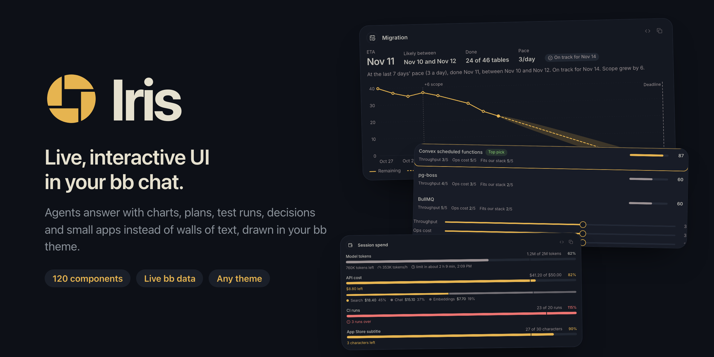
  </picture>
</p>

<p align="center">
  <a href="https://github.com/vburojevic/bb-plugin-iris/releases"></a>
  <a href="#components"></a>
  <a href="#evals"></a>
  <a href="https://getbb.app"></a>
  <a href="LICENSE"></a>
</p>

<h3 align="center">
  <a href="https://vburojevic.github.io/bb-plugin-iris/">Website</a>
  <span>·</span>
  <a href="https://vburojevic.github.io/bb-plugin-iris/#/play">Playground</a>
  <span>·</span>
  <a href="#install">Install</a>
  <span>·</span>
  <a href="#components">Components</a>
  <span>·</span>
  <a href="#live-data-from-bb-itself">Live data</a>
  <span>·</span>
  <a href="#for-agents">For agents</a>
</h3>

<br>

**Iris** is a [bb](https://getbb.app) plugin that lets agents answer with live, interactive UI instead of walls of text. An agent writes a short ```` ```iris ```` block, and bb draws it as a real card inside the reply: charts you can hover, sliders that recompute, tables you can sort, test runs that fill in while they run, pickers that wait for your answer. Every card wears your bb theme and follows it when you switch.

<p align="center">
  <a href="https://vburojevic.github.io/bb-plugin-iris/">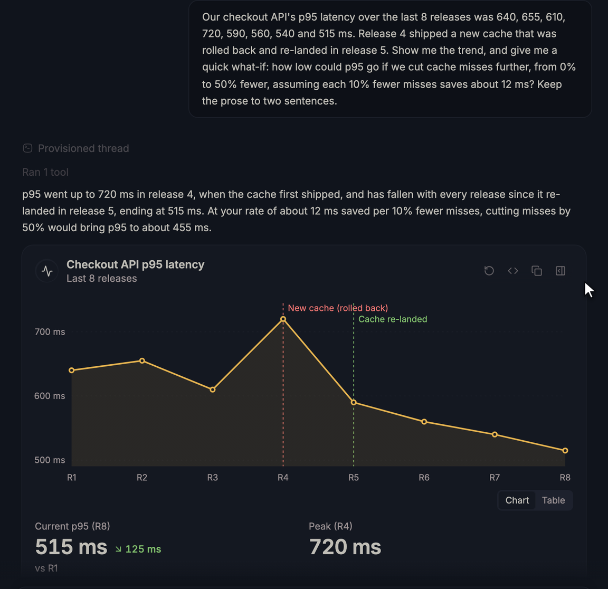</a>
  <br>
  <sub>A real bb thread at 60 fps: the person hovers a chart, drags a what-if slider and tunes a decision. <a href="https://vburojevic.github.io/bb-plugin-iris/">Watch it in full resolution</a>.</sub>
</p>

## Install

On a Mac running bb 0.48 or later:

```sh
bb plugin install "git:https://github.com/vburojevic/bb-plugin-iris.git@^1.0.0"
```

That's it. New agent sessions learn Iris on their own, and the gallery appears in bb's sidebar under **Iris**. Sessions that were already running pick it up when they next start or resume. Iris adds about 3,500 tokens of instructions to each session it reaches: its rules and an index of every component. Prop details and examples load only when an agent asks for them.

> [!TIP]
> Try every component in your browser first: the [playground](https://vburojevic.github.io/bb-plugin-iris/#/play) runs Iris's real renderer, with a live editor and links you can share.

## Why Iris

<table>
<tr>
<td width="50%" valign="top">
<picture><source media="(prefers-color-scheme: light)" srcset="docs/icons/light/presentation.svg"></picture>

**Show, don't tell.** Status reports, proof that work is done, PR and CI state, comparisons and plans come back as cards, with the answer in a sentence or two above them.
</td>
<td width="50%" valign="top">
<picture><source media="(prefers-color-scheme: light)" srcset="docs/icons/light/blocks.svg"></picture>

**129 components.** Layout, charts, data grids, diagrams, code and diffs, test and coverage reports, plans, decisions, maps, media, 3D, math, sheets, API inspectors, whiteboards and more. [See every one.](#components)
</td>
</tr>
<tr>
<td valign="top">
<picture><source media="(prefers-color-scheme: light)" srcset="docs/icons/light/palette.svg"></picture>

**Your theme, live.** Colors come only from your bb theme: the accent is its primary, tones use its success, warning and danger colors, and nothing has a palette of its own.
</td>
<td valign="top">
<picture><source media="(prefers-color-scheme: light)" srcset="docs/icons/light/activity.svg"></picture>

**Live data.** A live card re-reads its files every 2 seconds. `load("bb:...")` reads bb itself, and any plugin can feed cards through a [public data contract](#for-plugin-authors-live-data-in-iris-cards).
</td>
</tr>
<tr>
<td valign="top">
<picture><source media="(prefers-color-scheme: light)" srcset="docs/icons/light/mouse-pointer-click.svg"></picture>

**Interactive both ways.** Inputs recompute cards in place, buttons put text in your composer, and `iris_ask` opens a rich picker that waits for your answer, like bb's own ask mode: ranked checklists with badges, or design variants you flip through in a large preview.
</td>
<td valign="top">
<picture><source media="(prefers-color-scheme: light)" srcset="docs/icons/light/app-window.svg"></picture>

**Apps when you need them.** ```` ```iris-react ```` and ```` ```iris-app ```` run full React or HTML apps in a sandbox with no network, styled like native cards.
</td>
</tr>
<tr>
<td valign="top">
<picture><source media="(prefers-color-scheme: light)" srcset="docs/icons/light/shield-check.svg"></picture>

**Safe by design.** No `eval`: a sandboxed interpreter runs every expression under a step budget, cards make no network requests of their own, and web images load only when their URL is in the block. [More](#security)
</td>
<td valign="top">
<picture><source media="(prefers-color-scheme: light)" srcset="docs/icons/light/gauge.svg"></picture>

**Measured.** Every release passes an [eval suite](#evals) that runs real chat moments through an agent and scores whether it showed the right card.
</td>
</tr>
</table>

## How it works

An agent writes JSX-style markup with live values, and bb renders it as you read.

```iris
<state seats={10} plan="Pro" />
<let price={(plan == "Pro" ? 29 : 12) * seats} />
<Card title="Estimate" icon="calculator">
  <Row>
    <Segmented bind="plan" options={["Basic", "Pro"]} />
    <Slider bind="seats" min={1} max={50} label="Seats" />
  </Row>
  <Row>
    <Metric label="Per month" value={price} format="usd" />
    <Metric label="Per year" value={price * 12 * 0.85}
            format="usd" note="15% off yearly" />
  </Row>
</Card>
```

<picture>
  <source media="(prefers-color-scheme: light)" srcset="docs/estimate-light.webp">
  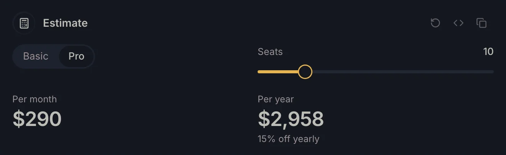
</picture>
<sub>That block, as bb draws it. Try it, and change it, in the <a href="https://vburojevic.github.io/bb-plugin-iris/#/play">playground</a>.</sub>

From the agent's reply to a card you can use:

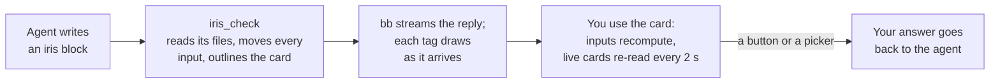

A broken part shows a readable error with an **Ask to fix** button while the rest of the card renders.

## Components

<!-- atlas:start -->

### The right card for the moment

<table>
<tr><td width="33%" valign="top"><a href="https://vburojevic.github.io/bb-plugin-iris/#/Acceptance"><picture><source media="(prefers-color-scheme: light)" srcset="docs/atlas/light/Acceptance.webp">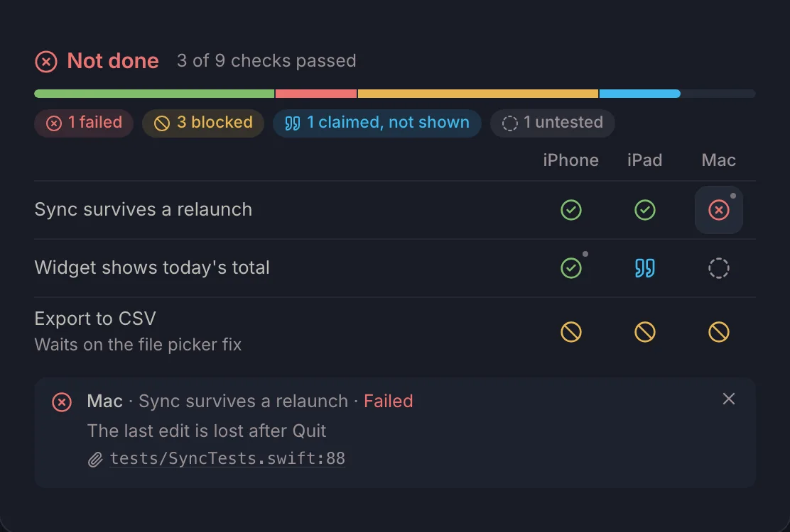</picture></a><br><b>Proof it's done</b><br><sub><a href="https://vburojevic.github.io/bb-plugin-iris/#/Acceptance"><code>Acceptance</code></a> Is it really done: each criterion with its status, a note and evidence that opens.</sub></td><td width="33%" valign="top"><a href="https://vburojevic.github.io/bb-plugin-iris/#/Decision"><picture><source media="(prefers-color-scheme: light)" srcset="docs/atlas/light/Decision.webp">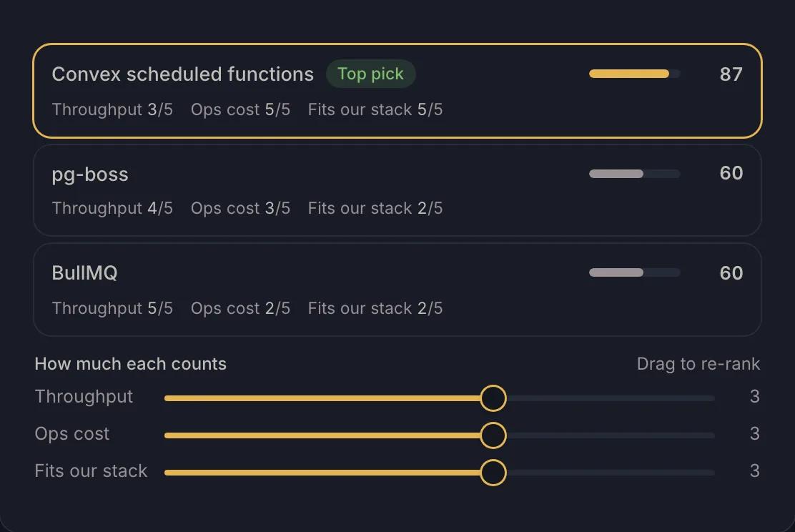</picture></a><br><b>A decision to make</b><br><sub><a href="https://vburojevic.github.io/bb-plugin-iris/#/Decision"><code>Decision</code></a> Options scored against criteria with weights people can tune; the ranking updates live.</sub></td><td width="33%" valign="top"><a href="https://vburojevic.github.io/bb-plugin-iris/#/Chart"><picture><source media="(prefers-color-scheme: light)" srcset="docs/atlas/light/Chart.webp">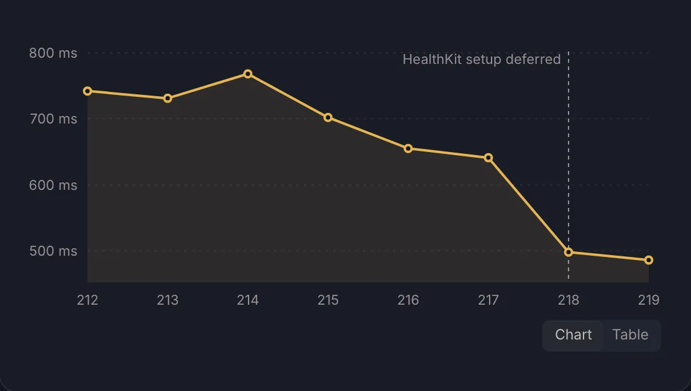</picture></a><br><b>Data to read</b><br><sub><a href="https://vburojevic.github.io/bb-plugin-iris/#/Chart"><code>Chart</code></a> Line, area, bar, horizontal bar, pie, donut, scatter and radar charts in the theme's colors, with hover readouts, annotations and a table view.</sub></td></tr>
<tr><td width="33%" valign="top"><a href="https://vburojevic.github.io/bb-plugin-iris/#/Tests"><picture><source media="(prefers-color-scheme: light)" srcset="docs/atlas/light/Tests.webp">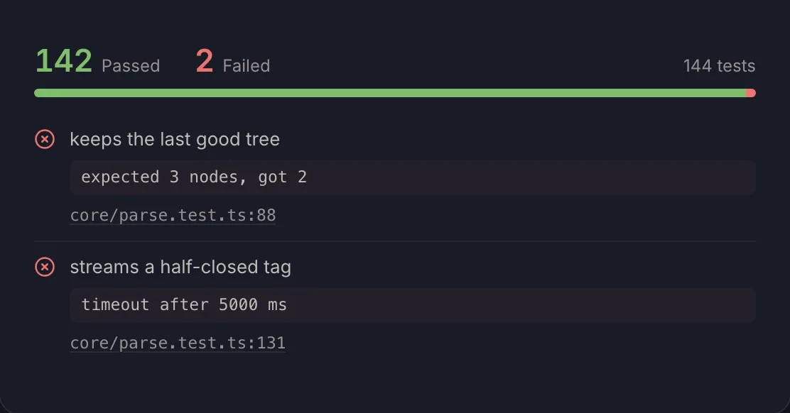</picture></a><br><b>A test run</b><br><sub><a href="https://vburojevic.github.io/bb-plugin-iris/#/Tests"><code>Tests</code></a> A test run: counts, failures first with messages and file links.</sub></td><td width="33%" valign="top"><a href="https://vburojevic.github.io/bb-plugin-iris/#/PullRequest"><picture><source media="(prefers-color-scheme: light)" srcset="docs/atlas/light/PullRequest.webp">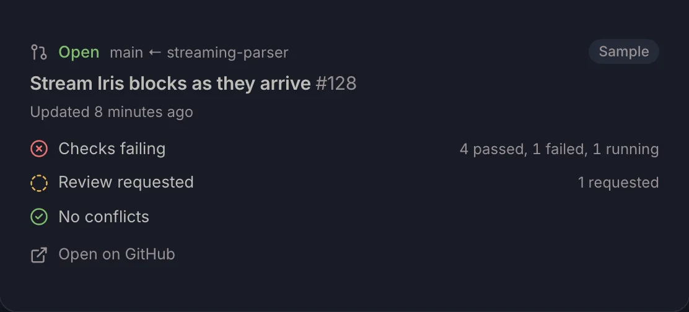</picture></a><br><b>Where the PR stands</b><br><sub><a href="https://vburojevic.github.io/bb-plugin-iris/#/PullRequest"><code>PullRequest</code></a> This branch's pull request: state, checks, review status, mergeability and a link.</sub></td><td width="33%" valign="top"><a href="https://vburojevic.github.io/bb-plugin-iris/#/Plan"><picture><source media="(prefers-color-scheme: light)" srcset="docs/atlas/light/Plan.webp">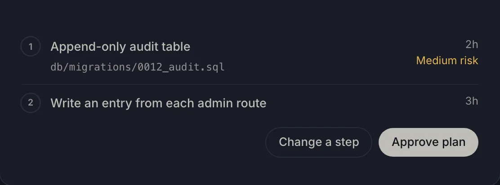</picture></a><br><b>A plan to approve</b><br><sub><a href="https://vburojevic.github.io/bb-plugin-iris/#/Plan"><code>Plan</code></a> Steps of work with files, risk and estimates.</sub></td></tr>
<tr><td width="33%" valign="top"><a href="https://vburojevic.github.io/bb-plugin-iris/#/Forecast"><picture><source media="(prefers-color-scheme: light)" srcset="docs/atlas/light/Forecast.webp">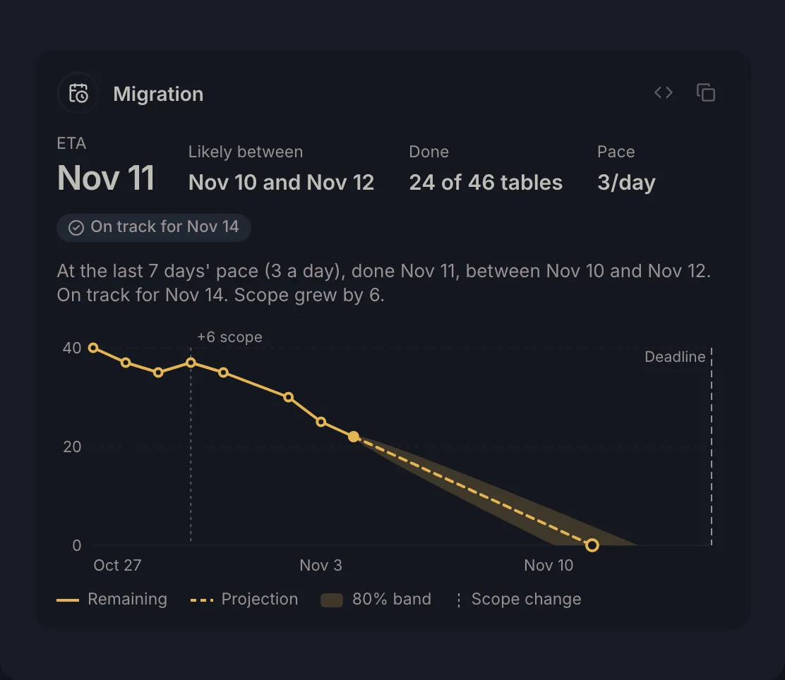</picture></a><br><b>When it will land</b><br><sub><a href="https://vburojevic.github.io/bb-plugin-iris/#/Forecast"><code>Forecast</code></a> Done counts over time as an ETA with a band from recent rates, a burn-down or burn-up, scope changes and plain words.</sub></td><td width="33%" valign="top"><a href="https://vburojevic.github.io/bb-plugin-iris/#/Budget"><picture><source media="(prefers-color-scheme: light)" srcset="docs/atlas/light/Budget.webp">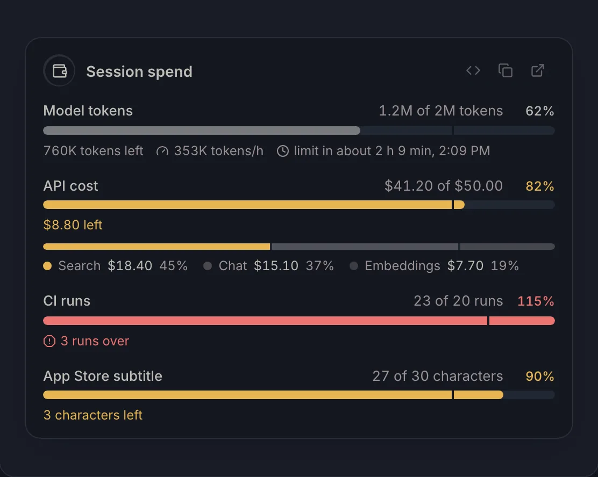</picture></a><br><b>Spend against a limit</b><br><sub><a href="https://vburojevic.github.io/bb-plugin-iris/#/Budget"><code>Budget</code></a> Spend against a limit: a meter per line, the total, a breakdown, the burn rate and when the limit is hit at it.</sub></td><td width="33%" valign="top"><a href="https://vburojevic.github.io/bb-plugin-iris/#/CompareGrid"><picture><source media="(prefers-color-scheme: light)" srcset="docs/atlas/light/CompareGrid.webp">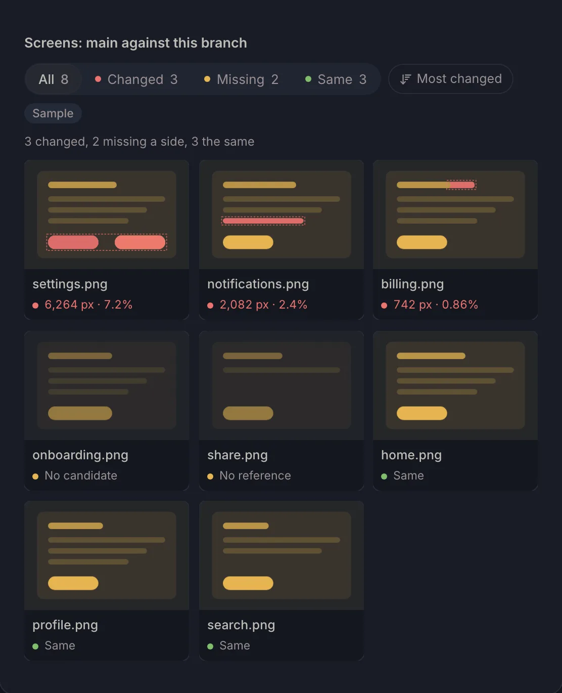</picture></a><br><b>What changed on screen</b><br><sub><a href="https://vburojevic.github.io/bb-plugin-iris/#/CompareGrid"><code>CompareGrid</code></a> Many before and after image pairs in a grid, each tile with its changed-pixel count and a status (changed, missing, same); sort and filter by change.</sub></td></tr>
</table>

### Every component, by family

Open a family to see each card as it renders in bb. Every picture links to its live page in the [playground](https://vburojevic.github.io/bb-plugin-iris/), with its code and every prop.

<details>
<summary><b>Layout</b> · 8 components: Card, Stack, Row, Grid, Tabs, Tab, Details, Divider</summary>
<br>

<table>
<tr><td width="33%" valign="top"><a href="https://vburojevic.github.io/bb-plugin-iris/#/Card"><picture><source media="(prefers-color-scheme: light)" srcset="docs/atlas/light/Card.webp">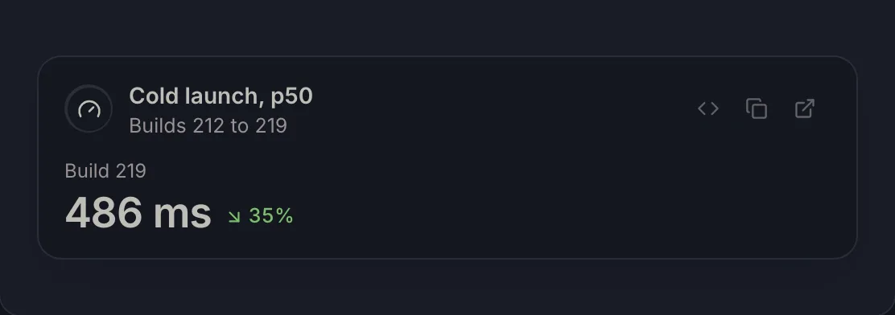</picture></a><br><a href="https://vburojevic.github.io/bb-plugin-iris/#/Card"><b>Card</b></a><br><sub>The frame for one idea: a titled surface with a toolbar (expand, export, source).</sub></td><td width="33%" valign="top"><a href="https://vburojevic.github.io/bb-plugin-iris/#/Stack"><picture><source media="(prefers-color-scheme: light)" srcset="docs/atlas/light/Stack.webp"></picture></a><br><a href="https://vburojevic.github.io/bb-plugin-iris/#/Stack"><b>Stack</b></a><br><sub>Children in a column with even spacing.</sub></td><td width="33%" valign="top"><a href="https://vburojevic.github.io/bb-plugin-iris/#/Row"><picture><source media="(prefers-color-scheme: light)" srcset="docs/atlas/light/Row.webp">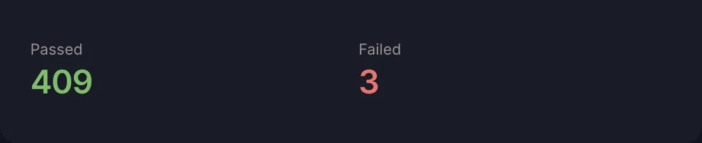</picture></a><br><a href="https://vburojevic.github.io/bb-plugin-iris/#/Row"><b>Row</b></a><br><sub>Children side by side with equal widths; wraps on narrow screens.</sub></td></tr>
<tr><td width="33%" valign="top"><a href="https://vburojevic.github.io/bb-plugin-iris/#/Grid"><picture><source media="(prefers-color-scheme: light)" srcset="docs/atlas/light/Grid.webp">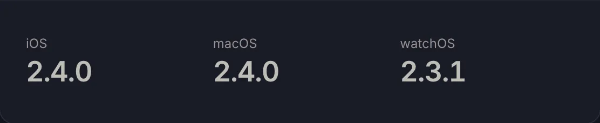</picture></a><br><a href="https://vburojevic.github.io/bb-plugin-iris/#/Grid"><b>Grid</b></a><br><sub>Tiles in a responsive grid.</sub></td><td width="33%" valign="top"><a href="https://vburojevic.github.io/bb-plugin-iris/#/Tabs"><picture><source media="(prefers-color-scheme: light)" srcset="docs/atlas/light/Tabs.webp">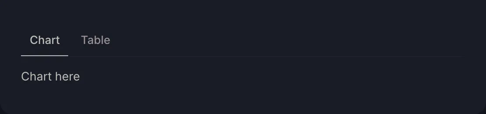</picture></a><br><a href="https://vburojevic.github.io/bb-plugin-iris/#/Tabs"><b>Tabs</b></a><br><sub>Switch between Tab children.</sub></td><td width="33%" valign="top"><a href="https://vburojevic.github.io/bb-plugin-iris/#/Tab"><picture><source media="(prefers-color-scheme: light)" srcset="docs/atlas/light/Tab.webp">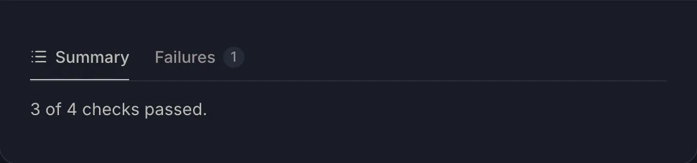</picture></a><br><a href="https://vburojevic.github.io/bb-plugin-iris/#/Tab"><b>Tab</b></a><br><sub>One page inside Tabs.</sub></td></tr>
<tr><td width="33%" valign="top"><a href="https://vburojevic.github.io/bb-plugin-iris/#/Details"><picture><source media="(prefers-color-scheme: light)" srcset="docs/atlas/light/Details.webp">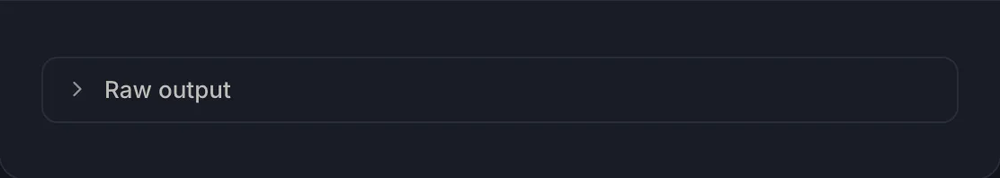</picture></a><br><a href="https://vburojevic.github.io/bb-plugin-iris/#/Details"><b>Details</b></a><br><sub>A collapsible section for secondary detail.</sub></td><td width="33%" valign="top"><a href="https://vburojevic.github.io/bb-plugin-iris/#/Divider"><picture><source media="(prefers-color-scheme: light)" srcset="docs/atlas/light/Divider.webp"></picture></a><br><a href="https://vburojevic.github.io/bb-plugin-iris/#/Divider"><b>Divider</b></a><br><sub>A hairline between sections, optionally labeled.</sub></td><td></td></tr>
</table>

</details>

<details>
<summary><b>Content</b> · 14 components: Text, Heading, Callout, Metric, Badge, Icon, KeyValue, List, Item, Link, Image, Progress, Gauge, Empty</summary>
<br>

<table>
<tr><td width="33%" valign="top"><a href="https://vburojevic.github.io/bb-plugin-iris/#/Text"><picture><source media="(prefers-color-scheme: light)" srcset="docs/atlas/light/Text.webp"></picture></a><br><a href="https://vburojevic.github.io/bb-plugin-iris/#/Text"><b>Text</b></a><br><sub>Markdown prose: bold, italics, `code`, links, lists.</sub></td><td width="33%" valign="top"><a href="https://vburojevic.github.io/bb-plugin-iris/#/Heading"><picture><source media="(prefers-color-scheme: light)" srcset="docs/atlas/light/Heading.webp"></picture></a><br><a href="https://vburojevic.github.io/bb-plugin-iris/#/Heading"><b>Heading</b></a><br><sub>A section heading inside a card.</sub></td><td width="33%" valign="top"><a href="https://vburojevic.github.io/bb-plugin-iris/#/Callout"><picture><source media="(prefers-color-scheme: light)" srcset="docs/atlas/light/Callout.webp">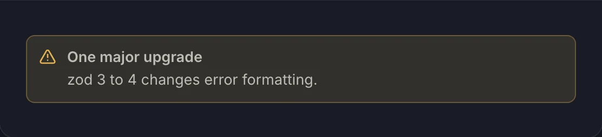</picture></a><br><a href="https://vburojevic.github.io/bb-plugin-iris/#/Callout"><b>Callout</b></a><br><sub>A highlighted note: a warning, a tip, the bottom line.</sub></td></tr>
<tr><td width="33%" valign="top"><a href="https://vburojevic.github.io/bb-plugin-iris/#/Metric"><picture><source media="(prefers-color-scheme: light)" srcset="docs/atlas/light/Metric.webp">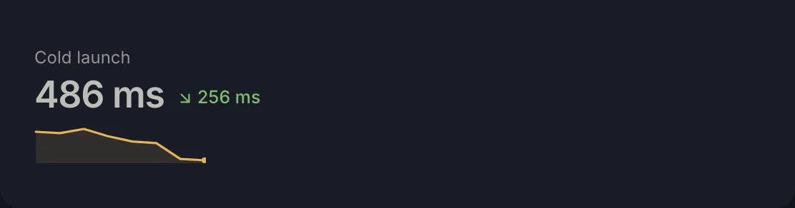</picture></a><br><a href="https://vburojevic.github.io/bb-plugin-iris/#/Metric"><b>Metric</b></a><br><sub>One key number with a label, an optional change and a sparkline.</sub></td><td width="33%" valign="top"><a href="https://vburojevic.github.io/bb-plugin-iris/#/Badge"><picture><source media="(prefers-color-scheme: light)" srcset="docs/atlas/light/Badge.webp"></picture></a><br><a href="https://vburojevic.github.io/bb-plugin-iris/#/Badge"><b>Badge</b></a><br><sub>A one to three word status chip.</sub></td><td width="33%" valign="top"><a href="https://vburojevic.github.io/bb-plugin-iris/#/Icon"><picture><source media="(prefers-color-scheme: light)" srcset="docs/atlas/light/Icon.webp"></picture></a><br><a href="https://vburojevic.github.io/bb-plugin-iris/#/Icon"><b>Icon</b></a><br><sub>A Lucide icon.</sub></td></tr>
<tr><td width="33%" valign="top"><a href="https://vburojevic.github.io/bb-plugin-iris/#/KeyValue"><picture><source media="(prefers-color-scheme: light)" srcset="docs/atlas/light/KeyValue.webp">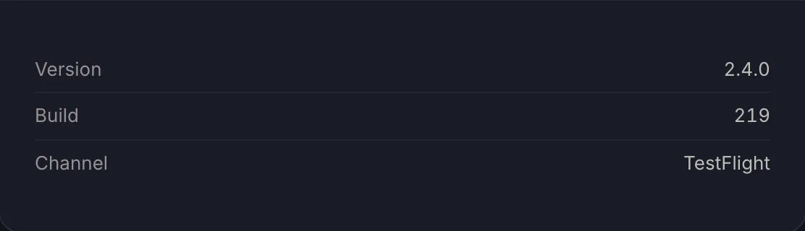</picture></a><br><a href="https://vburojevic.github.io/bb-plugin-iris/#/KeyValue"><b>KeyValue</b></a><br><sub>Labeled fields: settings, metadata, a summary.</sub></td><td width="33%" valign="top"><a href="https://vburojevic.github.io/bb-plugin-iris/#/List"><picture><source media="(prefers-color-scheme: light)" srcset="docs/atlas/light/List.webp">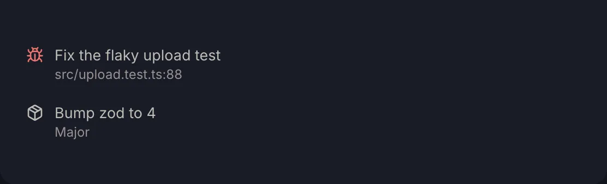</picture></a><br><a href="https://vburojevic.github.io/bb-plugin-iris/#/List"><b>List</b></a><br><sub>Rows with a title, detail, icon, trailing value and an optional click action.</sub></td><td width="33%" valign="top"><a href="https://vburojevic.github.io/bb-plugin-iris/#/Item"><picture><source media="(prefers-color-scheme: light)" srcset="docs/atlas/light/Item.webp">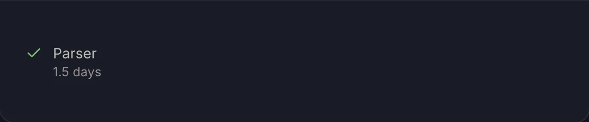</picture></a><br><a href="https://vburojevic.github.io/bb-plugin-iris/#/Item"><b>Item</b></a><br><sub>One row inside List.</sub></td></tr>
<tr><td width="33%" valign="top"><a href="https://vburojevic.github.io/bb-plugin-iris/#/Link"><picture><source media="(prefers-color-scheme: light)" srcset="docs/atlas/light/Link.webp"></picture></a><br><a href="https://vburojevic.github.io/bb-plugin-iris/#/Link"><b>Link</b></a><br><sub>A link to a URL or a workspace file.</sub></td><td width="33%" valign="top"><a href="https://vburojevic.github.io/bb-plugin-iris/#/Image"><picture><source media="(prefers-color-scheme: light)" srcset="docs/atlas/light/Image.webp">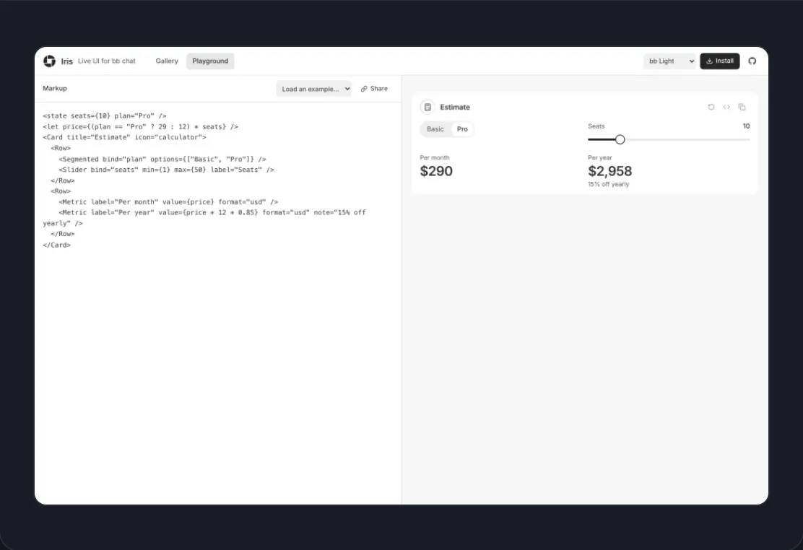</picture></a><br><a href="https://vburojevic.github.io/bb-plugin-iris/#/Image"><b>Image</b></a><br><sub>An image from the workspace, thread storage or an https URL.</sub></td><td width="33%" valign="top"><a href="https://vburojevic.github.io/bb-plugin-iris/#/Progress"><picture><source media="(prefers-color-scheme: light)" srcset="docs/atlas/light/Progress.webp">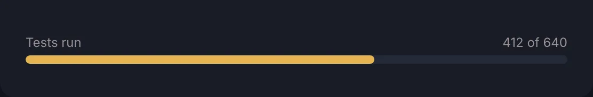</picture></a><br><a href="https://vburojevic.github.io/bb-plugin-iris/#/Progress"><b>Progress</b></a><br><sub>A bar showing how far along something is.</sub></td></tr>
<tr><td width="33%" valign="top"><a href="https://vburojevic.github.io/bb-plugin-iris/#/Gauge"><picture><source media="(prefers-color-scheme: light)" srcset="docs/atlas/light/Gauge.webp"></picture></a><br><a href="https://vburojevic.github.io/bb-plugin-iris/#/Gauge"><b>Gauge</b></a><br><sub>A dial for one value against a range.</sub></td><td width="33%" valign="top"><a href="https://vburojevic.github.io/bb-plugin-iris/#/Empty"><picture><source media="(prefers-color-scheme: light)" srcset="docs/atlas/light/Empty.webp"></picture></a><br><a href="https://vburojevic.github.io/bb-plugin-iris/#/Empty"><b>Empty</b></a><br><sub>What to show when there is nothing: an icon, a line and an optional action.</sub></td><td></td></tr>
</table>

</details>

<details>
<summary><b>Data</b> · 7 components: Table, Json, SegmentedBar, Sparkline, Heatmap, CalendarHeatmap, DataGrid</summary>
<br>

<table>
<tr><td width="33%" valign="top"><a href="https://vburojevic.github.io/bb-plugin-iris/#/Table"><picture><source media="(prefers-color-scheme: light)" srcset="docs/atlas/light/Table.webp">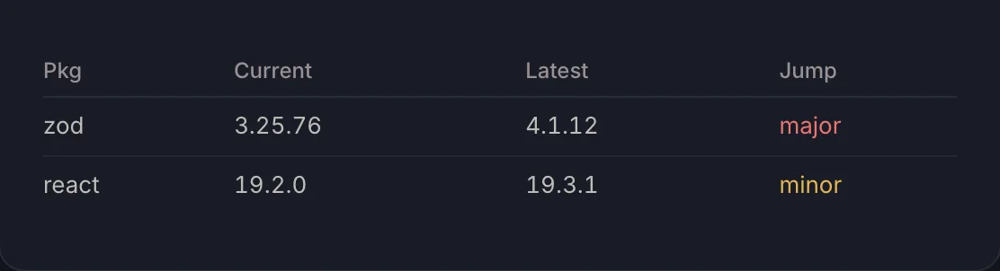</picture></a><br><a href="https://vburojevic.github.io/bb-plugin-iris/#/Table"><b>Table</b></a><br><sub>Rows and columns with sorting, search, paging and number formatting.</sub></td><td width="33%" valign="top"><a href="https://vburojevic.github.io/bb-plugin-iris/#/Json"><picture><source media="(prefers-color-scheme: light)" srcset="docs/atlas/light/Json.webp">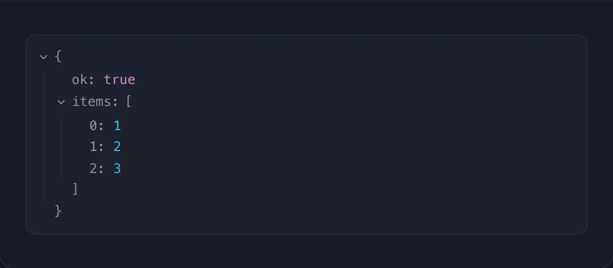</picture></a><br><a href="https://vburojevic.github.io/bb-plugin-iris/#/Json"><b>Json</b></a><br><sub>A collapsible JSON explorer for an object or a loaded file.</sub></td><td width="33%" valign="top"><a href="https://vburojevic.github.io/bb-plugin-iris/#/SegmentedBar"><picture><source media="(prefers-color-scheme: light)" srcset="docs/atlas/light/SegmentedBar.webp">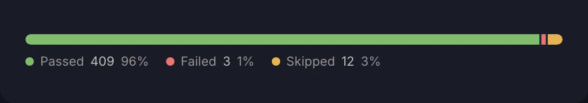</picture></a><br><a href="https://vburojevic.github.io/bb-plugin-iris/#/SegmentedBar"><b>SegmentedBar</b></a><br><sub>Shares of one whole as a single bar with a legend.</sub></td></tr>
<tr><td width="33%" valign="top"><a href="https://vburojevic.github.io/bb-plugin-iris/#/Sparkline"><picture><source media="(prefers-color-scheme: light)" srcset="docs/atlas/light/Sparkline.webp"></picture></a><br><a href="https://vburojevic.github.io/bb-plugin-iris/#/Sparkline"><b>Sparkline</b></a><br><sub>A tiny trend line for inline use.</sub></td><td width="33%" valign="top"><a href="https://vburojevic.github.io/bb-plugin-iris/#/Heatmap"><picture><source media="(prefers-color-scheme: light)" srcset="docs/atlas/light/Heatmap.webp">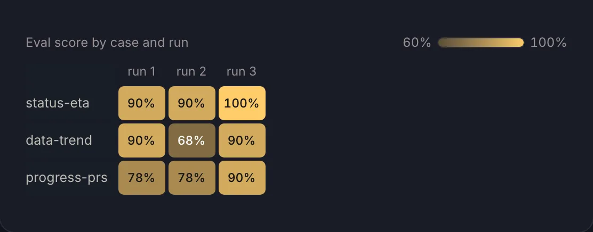</picture></a><br><a href="https://vburojevic.github.io/bb-plugin-iris/#/Heatmap"><b>Heatmap</b></a><br><sub>A grid of rows by columns, each cell colored by its value: eval scores by case and run, failures by suite and day, latency by route and region.</sub></td><td width="33%" valign="top"><a href="https://vburojevic.github.io/bb-plugin-iris/#/CalendarHeatmap"><picture><source media="(prefers-color-scheme: light)" srcset="docs/atlas/light/CalendarHeatmap.webp">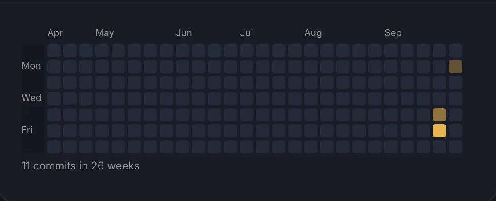</picture></a><br><a href="https://vburojevic.github.io/bb-plugin-iris/#/CalendarHeatmap"><b>CalendarHeatmap</b></a><br><sub>Activity per day on a calendar grid, like a contributions graph.</sub></td></tr>
<tr><td width="33%" valign="top"><a href="https://vburojevic.github.io/bb-plugin-iris/#/DataGrid"><picture><source media="(prefers-color-scheme: light)" srcset="docs/atlas/light/DataGrid.webp">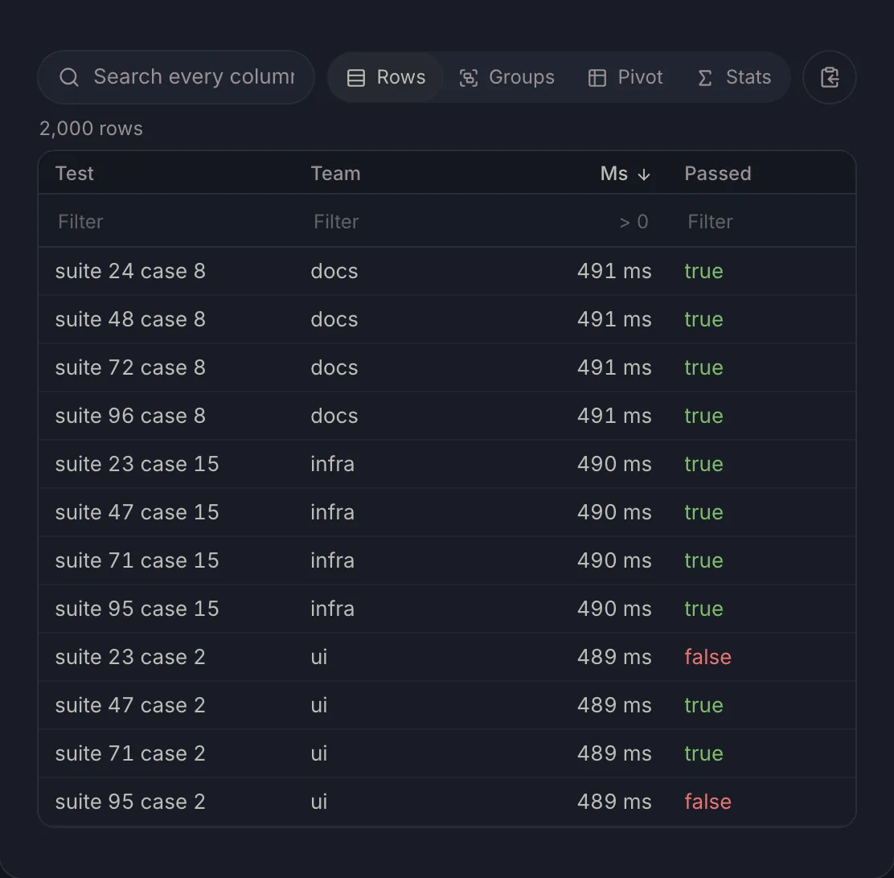</picture></a><br><a href="https://vburojevic.github.io/bb-plugin-iris/#/DataGrid"><b>DataGrid</b></a><br><sub>An explorer for large results (CSV, JSON, SQL.</sub></td><td></td><td></td></tr>
</table>

</details>

<details>
<summary><b>Charts</b> · 1 component: Chart</summary>
<br>

<table>
<tr><td width="33%" valign="top"><a href="https://vburojevic.github.io/bb-plugin-iris/#/Chart"><picture><source media="(prefers-color-scheme: light)" srcset="docs/atlas/light/Chart.webp"></picture></a><br><a href="https://vburojevic.github.io/bb-plugin-iris/#/Chart"><b>Chart</b></a><br><sub>Line, area, bar, horizontal bar, pie, donut, scatter and radar charts in the theme's colors, with hover readouts, annotations and a table view.</sub></td><td></td><td></td></tr>
</table>

</details>

<details>
<summary><b>Diagrams</b> · 3 components: Diagram, Tree, Graph</summary>
<br>

<table>
<tr><td width="33%" valign="top"><a href="https://vburojevic.github.io/bb-plugin-iris/#/Diagram"><picture><source media="(prefers-color-scheme: light)" srcset="docs/atlas/light/Diagram.webp">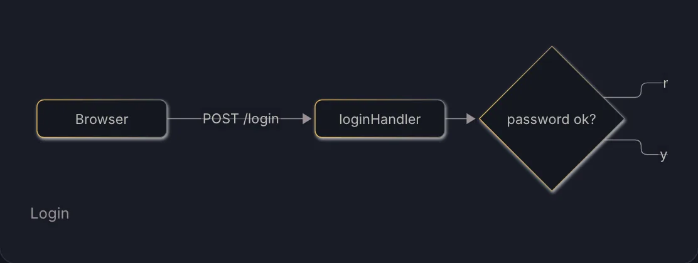</picture></a><br><a href="https://vburojevic.github.io/bb-plugin-iris/#/Diagram"><b>Diagram</b></a><br><sub>A Mermaid diagram (flowchart, sequence, state, class, ER, gantt).</sub></td><td width="33%" valign="top"><a href="https://vburojevic.github.io/bb-plugin-iris/#/Tree"><picture><source media="(prefers-color-scheme: light)" srcset="docs/atlas/light/Tree.webp">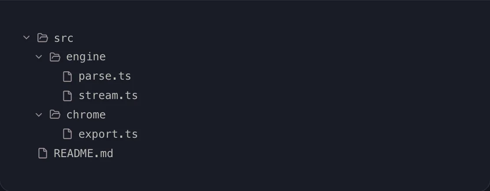</picture></a><br><a href="https://vburojevic.github.io/bb-plugin-iris/#/Tree"><b>Tree</b></a><br><sub>A collapsible tree: a file tree, a hierarchy, an outline.</sub></td><td width="33%" valign="top"><a href="https://vburojevic.github.io/bb-plugin-iris/#/Graph"><picture><source media="(prefers-color-scheme: light)" srcset="docs/atlas/light/Graph.webp">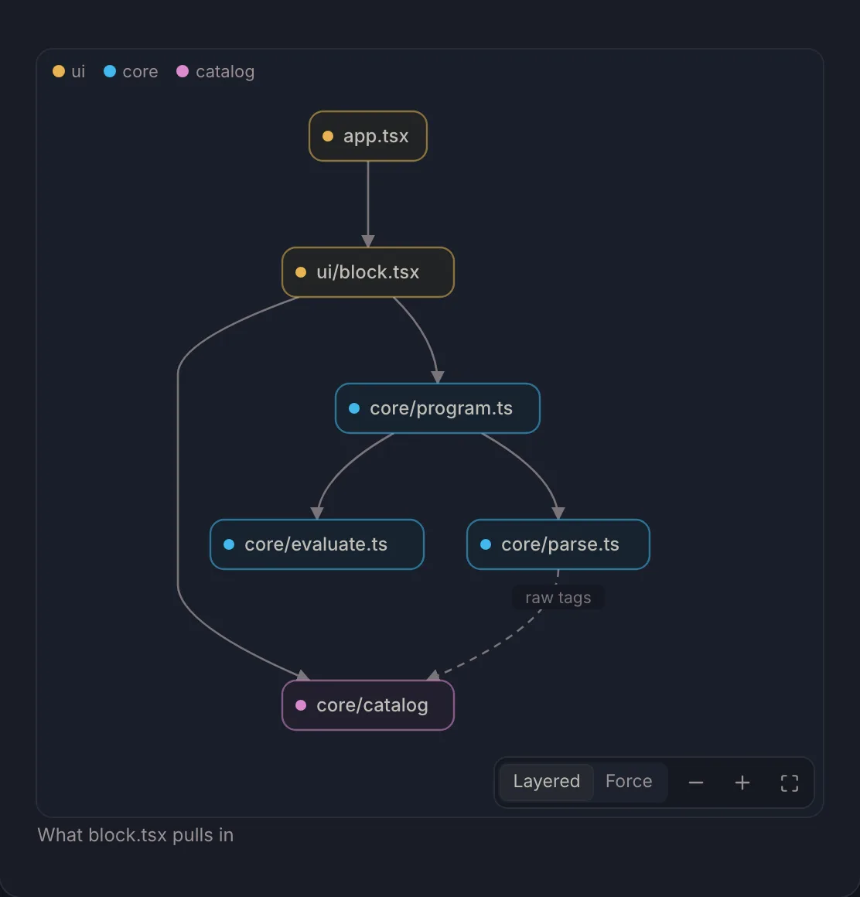</picture></a><br><a href="https://vburojevic.github.io/bb-plugin-iris/#/Graph"><b>Graph</b></a><br><sub>An interactive node-and-edge graph from data: dependency, call, module or service graphs.</sub></td></tr>
</table>

</details>

<details>
<summary><b>Code</b> · 5 components: Code, Snippet, Diff, Logs, StackTrace</summary>
<br>

<table>
<tr><td width="33%" valign="top"><a href="https://vburojevic.github.io/bb-plugin-iris/#/Code"><picture><source media="(prefers-color-scheme: light)" srcset="docs/atlas/light/Code.webp">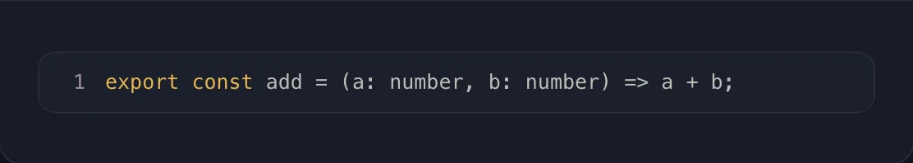</picture></a><br><a href="https://vburojevic.github.io/bb-plugin-iris/#/Code"><b>Code</b></a><br><sub>A code block with syntax highlighting in bb's code theme.</sub></td><td width="33%" valign="top"><a href="https://vburojevic.github.io/bb-plugin-iris/#/Snippet"><picture><source media="(prefers-color-scheme: light)" srcset="docs/atlas/light/Snippet.webp">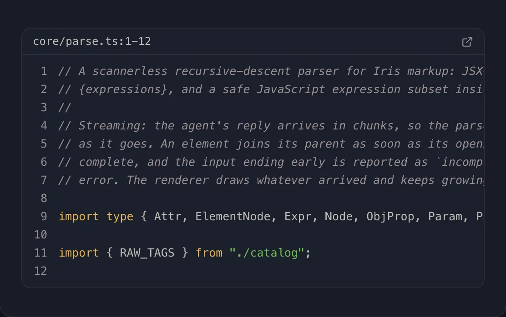</picture></a><br><a href="https://vburojevic.github.io/bb-plugin-iris/#/Snippet"><b>Snippet</b></a><br><sub>Lines of a real file from the workspace, read when the card renders; clicking opens the file.</sub></td><td width="33%" valign="top"><a href="https://vburojevic.github.io/bb-plugin-iris/#/Diff"><picture><source media="(prefers-color-scheme: light)" srcset="docs/atlas/light/Diff.webp">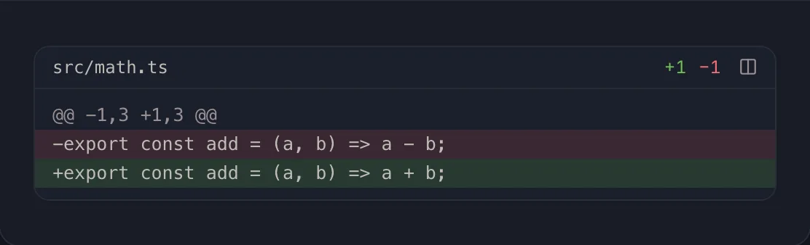</picture></a><br><a href="https://vburojevic.github.io/bb-plugin-iris/#/Diff"><b>Diff</b></a><br><sub>A unified diff for one file in bb's diff viewer, unified or split.</sub></td></tr>
<tr><td width="33%" valign="top"><a href="https://vburojevic.github.io/bb-plugin-iris/#/Logs"><picture><source media="(prefers-color-scheme: light)" srcset="docs/atlas/light/Logs.webp">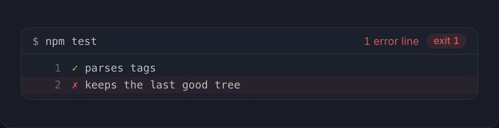</picture></a><br><a href="https://vburojevic.github.io/bb-plugin-iris/#/Logs"><b>Logs</b></a><br><sub>Command output with real ANSI colors, line numbers, a filter and error lines marked.</sub></td><td width="33%" valign="top"><a href="https://vburojevic.github.io/bb-plugin-iris/#/StackTrace"><picture><source media="(prefers-color-scheme: light)" srcset="docs/atlas/light/StackTrace.webp">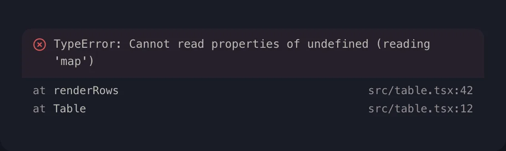</picture></a><br><a href="https://vburojevic.github.io/bb-plugin-iris/#/StackTrace"><b>StackTrace</b></a><br><sub>An error and its stack with your own frames highlighted and clickable; library frames fold away.</sub></td><td></td></tr>
</table>

</details>

<details>
<summary><b>Project</b> · 11 components: Tests, Findings, Coverage, Benchmark, Delta, Changes, Commits, PullRequest, Environments, Threads, Pipeline</summary>
<br>

<table>
<tr><td width="33%" valign="top"><a href="https://vburojevic.github.io/bb-plugin-iris/#/Tests"><picture><source media="(prefers-color-scheme: light)" srcset="docs/atlas/light/Tests.webp"></picture></a><br><a href="https://vburojevic.github.io/bb-plugin-iris/#/Tests"><b>Tests</b></a><br><sub>A test run: counts, failures first with messages and file links.</sub></td><td width="33%" valign="top"><a href="https://vburojevic.github.io/bb-plugin-iris/#/Findings"><picture><source media="(prefers-color-scheme: light)" srcset="docs/atlas/light/Findings.webp">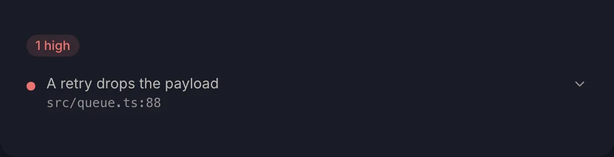</picture></a><br><a href="https://vburojevic.github.io/bb-plugin-iris/#/Findings"><b>Findings</b></a><br><sub>Review, lint or type errors grouped by severity, each with file, line, detail and fix.</sub></td><td width="33%" valign="top"><a href="https://vburojevic.github.io/bb-plugin-iris/#/Coverage"><picture><source media="(prefers-color-scheme: light)" srcset="docs/atlas/light/Coverage.webp">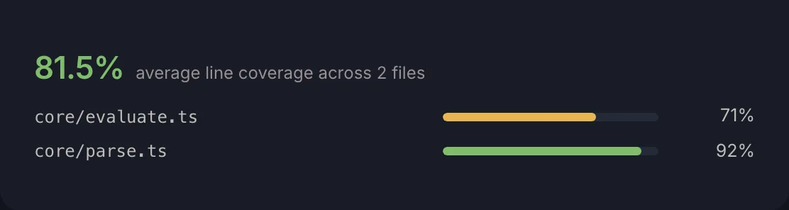</picture></a><br><a href="https://vburojevic.github.io/bb-plugin-iris/#/Coverage"><b>Coverage</b></a><br><sub>Code coverage per file with the weakest files first.</sub></td></tr>
<tr><td width="33%" valign="top"><a href="https://vburojevic.github.io/bb-plugin-iris/#/Benchmark"><picture><source media="(prefers-color-scheme: light)" srcset="docs/atlas/light/Benchmark.webp">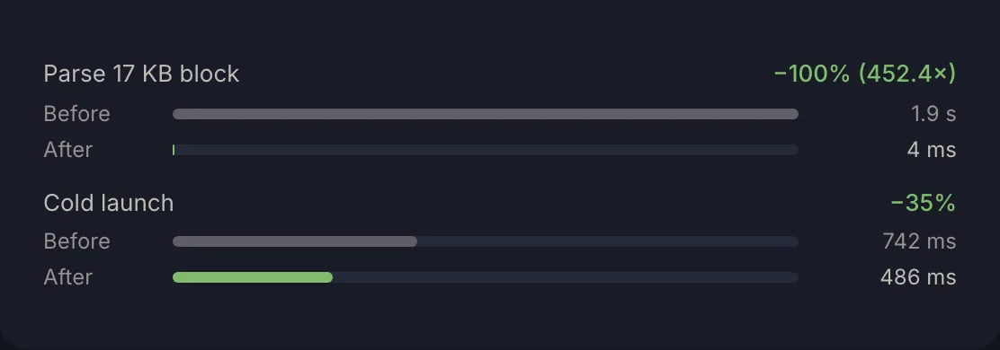</picture></a><br><a href="https://vburojevic.github.io/bb-plugin-iris/#/Benchmark"><b>Benchmark</b></a><br><sub>Before and after timings with the change and whether it improved.</sub></td><td width="33%" valign="top"><a href="https://vburojevic.github.io/bb-plugin-iris/#/Delta"><picture><source media="(prefers-color-scheme: light)" srcset="docs/atlas/light/Delta.webp">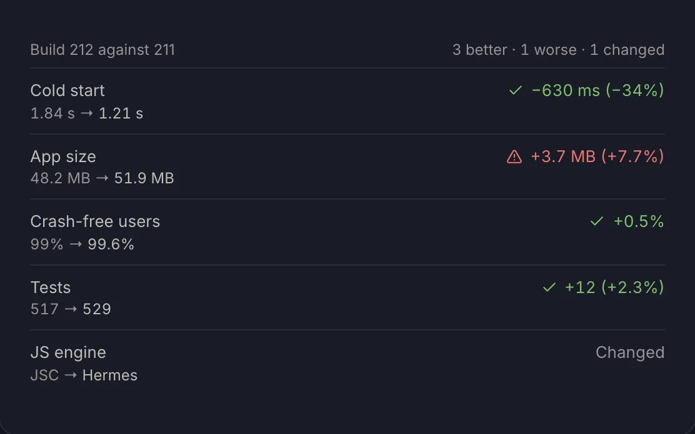</picture></a><br><a href="https://vburojevic.github.io/bb-plugin-iris/#/Delta"><b>Delta</b></a><br><sub>Before and after for any values: each row's change, its percent and whether it went the right way, with a tally of better, worse and same.</sub></td><td width="33%" valign="top"><a href="https://vburojevic.github.io/bb-plugin-iris/#/Changes"><picture><source media="(prefers-color-scheme: light)" srcset="docs/atlas/light/Changes.webp">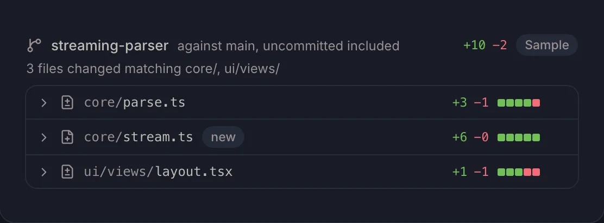</picture></a><br><a href="https://vburojevic.github.io/bb-plugin-iris/#/Changes"><b>Changes</b></a><br><sub>Files changed in this thread's checkout with +/- counts; each expands to its diff.</sub></td></tr>
<tr><td width="33%" valign="top"><a href="https://vburojevic.github.io/bb-plugin-iris/#/Commits"><picture><source media="(prefers-color-scheme: light)" srcset="docs/atlas/light/Commits.webp">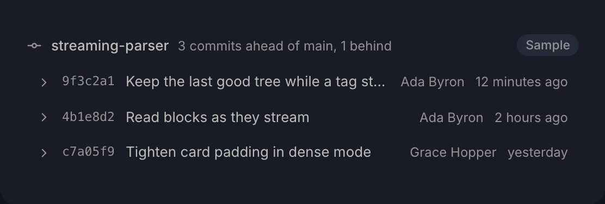</picture></a><br><a href="https://vburojevic.github.io/bb-plugin-iris/#/Commits"><b>Commits</b></a><br><sub>This branch's commits since the default branch, newest first; each opens its changes.</sub></td><td width="33%" valign="top"><a href="https://vburojevic.github.io/bb-plugin-iris/#/PullRequest"><picture><source media="(prefers-color-scheme: light)" srcset="docs/atlas/light/PullRequest.webp"></picture></a><br><a href="https://vburojevic.github.io/bb-plugin-iris/#/PullRequest"><b>PullRequest</b></a><br><sub>This branch's pull request: state, checks, review status, mergeability and a link.</sub></td><td width="33%" valign="top"><a href="https://vburojevic.github.io/bb-plugin-iris/#/Environments"><picture><source media="(prefers-color-scheme: light)" srcset="docs/atlas/light/Environments.webp">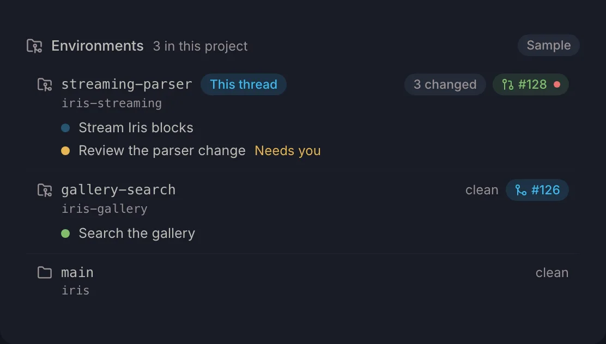</picture></a><br><a href="https://vburojevic.github.io/bb-plugin-iris/#/Environments"><b>Environments</b></a><br><sub>This project's worktrees: branch, threads in each, changed file count and pull request.</sub></td></tr>
<tr><td width="33%" valign="top"><a href="https://vburojevic.github.io/bb-plugin-iris/#/Threads"><picture><source media="(prefers-color-scheme: light)" srcset="docs/atlas/light/Threads.webp">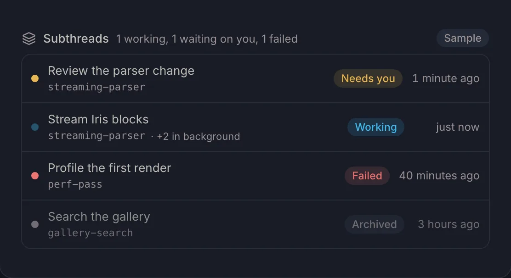</picture></a><br><a href="https://vburojevic.github.io/bb-plugin-iris/#/Threads"><b>Threads</b></a><br><sub>Live status of bb threads: running, waiting on the person, done, failed.</sub></td><td width="33%" valign="top"><a href="https://vburojevic.github.io/bb-plugin-iris/#/Pipeline"><picture><source media="(prefers-color-scheme: light)" srcset="docs/atlas/light/Pipeline.webp">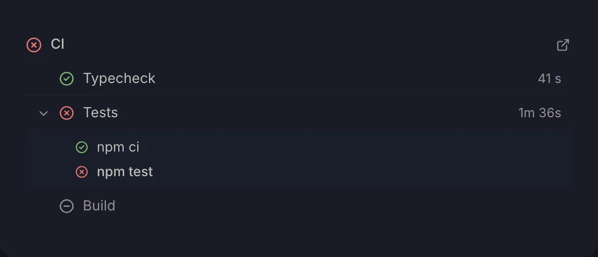</picture></a><br><a href="https://vburojevic.github.io/bb-plugin-iris/#/Pipeline"><b>Pipeline</b></a><br><sub>A CI run: runs, jobs and steps with status and duration, failures open.</sub></td><td></td></tr>
</table>

</details>

<details>
<summary><b>Evidence</b> · 4 components: Acceptance, Compare, CompareGrid, Provenance</summary>
<br>

<table>
<tr><td width="33%" valign="top"><a href="https://vburojevic.github.io/bb-plugin-iris/#/Acceptance"><picture><source media="(prefers-color-scheme: light)" srcset="docs/atlas/light/Acceptance.webp"></picture></a><br><a href="https://vburojevic.github.io/bb-plugin-iris/#/Acceptance"><b>Acceptance</b></a><br><sub>Is it really done: each criterion with its status, a note and evidence that opens.</sub></td><td width="33%" valign="top"><a href="https://vburojevic.github.io/bb-plugin-iris/#/Compare"><picture><source media="(prefers-color-scheme: light)" srcset="docs/atlas/light/Compare.webp">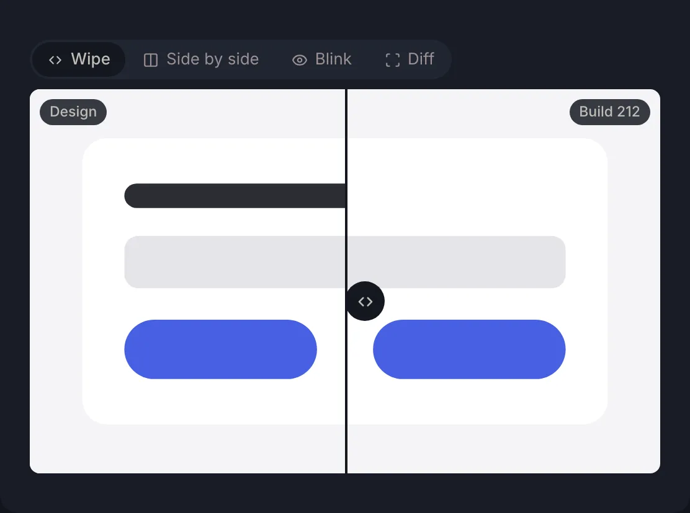</picture></a><br><a href="https://vburojevic.github.io/bb-plugin-iris/#/Compare"><b>Compare</b></a><br><sub>A visual difference between screenshots, reference first: wipe (a draggable divider), side by side, blink, or diff (changed pixels marked, with a count).</sub></td><td width="33%" valign="top"><a href="https://vburojevic.github.io/bb-plugin-iris/#/CompareGrid"><picture><source media="(prefers-color-scheme: light)" srcset="docs/atlas/light/CompareGrid.webp"></picture></a><br><a href="https://vburojevic.github.io/bb-plugin-iris/#/CompareGrid"><b>CompareGrid</b></a><br><sub>Many before and after image pairs in a grid, each tile with its changed-pixel count and a status (changed, missing, same); sort and filter by change.</sub></td></tr>
<tr><td width="33%" valign="top"><a href="https://vburojevic.github.io/bb-plugin-iris/#/Provenance"><picture><source media="(prefers-color-scheme: light)" srcset="docs/atlas/light/Provenance.webp"></picture></a><br><a href="https://vburojevic.github.io/bb-plugin-iris/#/Provenance"><b>Provenance</b></a><br><sub>Which build or revision is really installed or deployed where, from source to live, one stage per step.</sub></td><td></td><td></td></tr>
</table>

</details>

<details>
<summary><b>Planning</b> · 9 components: Plan, Steps, Timeline, Decision, Board, Roadmap, Estimate, Calendar, Status</summary>
<br>

<table>
<tr><td width="33%" valign="top"><a href="https://vburojevic.github.io/bb-plugin-iris/#/Plan"><picture><source media="(prefers-color-scheme: light)" srcset="docs/atlas/light/Plan.webp"></picture></a><br><a href="https://vburojevic.github.io/bb-plugin-iris/#/Plan"><b>Plan</b></a><br><sub>Steps of work with files, risk and estimates.</sub></td><td width="33%" valign="top"><a href="https://vburojevic.github.io/bb-plugin-iris/#/Steps"><picture><source media="(prefers-color-scheme: light)" srcset="docs/atlas/light/Steps.webp"></picture></a><br><a href="https://vburojevic.github.io/bb-plugin-iris/#/Steps"><b>Steps</b></a><br><sub>A checklist of progress: done, current, todo, blocked.</sub></td><td width="33%" valign="top"><a href="https://vburojevic.github.io/bb-plugin-iris/#/Timeline"><picture><source media="(prefers-color-scheme: light)" srcset="docs/atlas/light/Timeline.webp"></picture></a><br><a href="https://vburojevic.github.io/bb-plugin-iris/#/Timeline"><b>Timeline</b></a><br><sub>Dated events in order, newest or oldest first.</sub></td></tr>
<tr><td width="33%" valign="top"><a href="https://vburojevic.github.io/bb-plugin-iris/#/Decision"><picture><source media="(prefers-color-scheme: light)" srcset="docs/atlas/light/Decision.webp"></picture></a><br><a href="https://vburojevic.github.io/bb-plugin-iris/#/Decision"><b>Decision</b></a><br><sub>Options scored against criteria with weights people can tune; the ranking updates live.</sub></td><td width="33%" valign="top"><a href="https://vburojevic.github.io/bb-plugin-iris/#/Board"><picture><source media="(prefers-color-scheme: light)" srcset="docs/atlas/light/Board.webp"></picture></a><br><a href="https://vburojevic.github.io/bb-plugin-iris/#/Board"><b>Board</b></a><br><sub>A kanban board: cards in status columns.</sub></td><td width="33%" valign="top"><a href="https://vburojevic.github.io/bb-plugin-iris/#/Roadmap"><picture><source media="(prefers-color-scheme: light)" srcset="docs/atlas/light/Roadmap.webp"></picture></a><br><a href="https://vburojevic.github.io/bb-plugin-iris/#/Roadmap"><b>Roadmap</b></a><br><sub>A Gantt chart of dated work in lanes, with milestones and a today line.</sub></td></tr>
<tr><td width="33%" valign="top"><a href="https://vburojevic.github.io/bb-plugin-iris/#/Estimate"><picture><source media="(prefers-color-scheme: light)" srcset="docs/atlas/light/Estimate.webp"></picture></a><br><a href="https://vburojevic.github.io/bb-plugin-iris/#/Estimate"><b>Estimate</b></a><br><sub>Three-point estimates with P50 and P90 totals.</sub></td><td width="33%" valign="top"><a href="https://vburojevic.github.io/bb-plugin-iris/#/Calendar"><picture><source media="(prefers-color-scheme: light)" srcset="docs/atlas/light/Calendar.webp"></picture></a><br><a href="https://vburojevic.github.io/bb-plugin-iris/#/Calendar"><b>Calendar</b></a><br><sub>Events on a month grid.</sub></td><td width="33%" valign="top"><a href="https://vburojevic.github.io/bb-plugin-iris/#/Status"><picture><source media="(prefers-color-scheme: light)" srcset="docs/atlas/light/Status.webp"></picture></a><br><a href="https://vburojevic.github.io/bb-plugin-iris/#/Status"><b>Status</b></a><br><sub>Health of several workstreams: on track, at risk, off track, done.</sub></td></tr>
</table>

</details>

<details>
<summary><b>Inputs</b> · 14 components: Slider, Stepper, Toggle, Segmented, Select, Radio, Checklist, Rank, ColorInput, Input, TextArea, DateInput, Rating, Button</summary>
<br>

<table>
<tr><td width="33%" valign="top"><a href="https://vburojevic.github.io/bb-plugin-iris/#/Slider"><picture><source media="(prefers-color-scheme: light)" srcset="docs/atlas/light/Slider.webp"></picture></a><br><a href="https://vburojevic.github.io/bb-plugin-iris/#/Slider"><b>Slider</b></a><br><sub>Pick a number on a range; the card recomputes live.</sub></td><td width="33%" valign="top"><a href="https://vburojevic.github.io/bb-plugin-iris/#/Stepper"><picture><source media="(prefers-color-scheme: light)" srcset="docs/atlas/light/Stepper.webp"></picture></a><br><a href="https://vburojevic.github.io/bb-plugin-iris/#/Stepper"><b>Stepper</b></a><br><sub>A count with minus and plus buttons.</sub></td><td width="33%" valign="top"><a href="https://vburojevic.github.io/bb-plugin-iris/#/Toggle"><picture><source media="(prefers-color-scheme: light)" srcset="docs/atlas/light/Toggle.webp"></picture></a><br><a href="https://vburojevic.github.io/bb-plugin-iris/#/Toggle"><b>Toggle</b></a><br><sub>An on/off switch.</sub></td></tr>
<tr><td width="33%" valign="top"><a href="https://vburojevic.github.io/bb-plugin-iris/#/Segmented"><picture><source media="(prefers-color-scheme: light)" srcset="docs/atlas/light/Segmented.webp"></picture></a><br><a href="https://vburojevic.github.io/bb-plugin-iris/#/Segmented"><b>Segmented</b></a><br><sub>Pick one of a few short options.</sub></td><td width="33%" valign="top"><a href="https://vburojevic.github.io/bb-plugin-iris/#/Select"><picture><source media="(prefers-color-scheme: light)" srcset="docs/atlas/light/Select.webp"></picture></a><br><a href="https://vburojevic.github.io/bb-plugin-iris/#/Select"><b>Select</b></a><br><sub>Pick one of many options from a menu.</sub></td><td width="33%" valign="top"><a href="https://vburojevic.github.io/bb-plugin-iris/#/Radio"><picture><source media="(prefers-color-scheme: light)" srcset="docs/atlas/light/Radio.webp"></picture></a><br><a href="https://vburojevic.github.io/bb-plugin-iris/#/Radio"><b>Radio</b></a><br><sub>Pick one option, each with a detail line.</sub></td></tr>
<tr><td width="33%" valign="top"><a href="https://vburojevic.github.io/bb-plugin-iris/#/Checklist"><picture><source media="(prefers-color-scheme: light)" srcset="docs/atlas/light/Checklist.webp"></picture></a><br><a href="https://vburojevic.github.io/bb-plugin-iris/#/Checklist"><b>Checklist</b></a><br><sub>Pick several options; the state is a list of the picked values.</sub></td><td></td><td width="33%" valign="top"><a href="https://vburojevic.github.io/bb-plugin-iris/#/ColorInput"><picture><source media="(prefers-color-scheme: light)" srcset="docs/atlas/light/ColorInput.webp"></picture></a><br><a href="https://vburojevic.github.io/bb-plugin-iris/#/ColorInput"><b>ColorInput</b></a><br><sub>Pick a color: a swatch that opens the system picker, a hex field, optional presets, and the contrast on each background it will sit on.</sub></td></tr>
<tr><td width="33%" valign="top"><a href="https://vburojevic.github.io/bb-plugin-iris/#/Input"><picture><source media="(prefers-color-scheme: light)" srcset="docs/atlas/light/Input.webp"></picture></a><br><a href="https://vburojevic.github.io/bb-plugin-iris/#/Input"><b>Input</b></a><br><sub>A one-line text field.</sub></td><td width="33%" valign="top"><a href="https://vburojevic.github.io/bb-plugin-iris/#/TextArea"><picture><source media="(prefers-color-scheme: light)" srcset="docs/atlas/light/TextArea.webp"></picture></a><br><a href="https://vburojevic.github.io/bb-plugin-iris/#/TextArea"><b>TextArea</b></a><br><sub>A multi-line text field.</sub></td><td width="33%" valign="top"><a href="https://vburojevic.github.io/bb-plugin-iris/#/DateInput"><picture><source media="(prefers-color-scheme: light)" srcset="docs/atlas/light/DateInput.webp"></picture></a><br><a href="https://vburojevic.github.io/bb-plugin-iris/#/DateInput"><b>DateInput</b></a><br><sub>Pick a date (yyyy-mm-dd).</sub></td></tr>
<tr><td width="33%" valign="top"><a href="https://vburojevic.github.io/bb-plugin-iris/#/Rating"><picture><source media="(prefers-color-scheme: light)" srcset="docs/atlas/light/Rating.webp"></picture></a><br><a href="https://vburojevic.github.io/bb-plugin-iris/#/Rating"><b>Rating</b></a><br><sub>One to N stars.</sub></td><td width="33%" valign="top"><a href="https://vburojevic.github.io/bb-plugin-iris/#/Button"><picture><source media="(prefers-color-scheme: light)" srcset="docs/atlas/light/Button.webp"></picture></a><br><a href="https://vburojevic.github.io/bb-plugin-iris/#/Button"><b>Button</b></a><br><sub>Runs an action: change state, put text in the composer, send it, copy, open a file or URL.</sub></td><td></td></tr>
</table>

</details>

<details>
<summary><b>Pickers</b> · 5 components: FollowUps, Choices, Submit, Variants, Variant</summary>
<br>

<table>
<tr><td width="33%" valign="top"><a href="https://vburojevic.github.io/bb-plugin-iris/#/FollowUps"><picture><source media="(prefers-color-scheme: light)" srcset="docs/atlas/light/FollowUps.webp"></picture></a><br><a href="https://vburojevic.github.io/bb-plugin-iris/#/FollowUps"><b>FollowUps</b></a><br><sub>Suggested next prompts after a finished answer.</sub></td><td width="33%" valign="top"><a href="https://vburojevic.github.io/bb-plugin-iris/#/Choices"><picture><source media="(prefers-color-scheme: light)" srcset="docs/atlas/light/Choices.webp"></picture></a><br><a href="https://vburojevic.github.io/bb-plugin-iris/#/Choices"><b>Choices</b></a><br><sub>Optional next steps after a finished turn as tappable cards; the pick goes into the composer.</sub></td><td width="33%" valign="top"><a href="https://vburojevic.github.io/bb-plugin-iris/#/Submit"><picture><source media="(prefers-color-scheme: light)" srcset="docs/atlas/light/Submit.webp"></picture></a><br><a href="https://vburojevic.github.io/bb-plugin-iris/#/Submit"><b>Submit</b></a><br><sub>Only inside an iris_ask picker: sends the answer back to you.</sub></td></tr>
<tr><td width="33%" valign="top"><a href="https://vburojevic.github.io/bb-plugin-iris/#/Variants"><picture><source media="(prefers-color-scheme: light)" srcset="docs/atlas/light/Variants.webp"></picture></a><br><a href="https://vburojevic.github.io/bb-plugin-iris/#/Variants"><b>Variants</b></a><br><sub>Design directions to flip through: one large preview at a time with a switcher, arrows and keys.</sub></td><td width="33%" valign="top"><a href="https://vburojevic.github.io/bb-plugin-iris/#/Variant"><picture><source media="(prefers-color-scheme: light)" srcset="docs/atlas/light/Variant.webp"></picture></a><br><a href="https://vburojevic.github.io/bb-plugin-iris/#/Variant"><b>Variant</b></a><br><sub>One direction inside Variants: its preview is its children, or html for a sandboxed mock page.</sub></td><td></td></tr>
</table>

</details>

<details>
<summary><b>Media</b> · 8 components: Gallery, Screens, Hotspots, Map, PhotoSearch, VideoPlayer, VideoCompare, AudioPlayer</summary>
<br>

<table>
<tr><td width="33%" valign="top"><a href="https://vburojevic.github.io/bb-plugin-iris/#/Gallery"><picture><source media="(prefers-color-scheme: light)" srcset="docs/atlas/light/Gallery.webp"></picture></a><br><a href="https://vburojevic.github.io/bb-plugin-iris/#/Gallery"><b>Gallery</b></a><br><sub>Images in a grid; a click opens a lightbox with arrows, Esc to close and the caption.</sub></td><td width="33%" valign="top"><a href="https://vburojevic.github.io/bb-plugin-iris/#/Screens"><picture><source media="(prefers-color-scheme: light)" srcset="docs/atlas/light/Screens.webp"></picture></a><br><a href="https://vburojevic.github.io/bb-plugin-iris/#/Screens"><b>Screens</b></a><br><sub>Screenshots as a matrix: one row per screen, one column per device, theme or locale, each tile with its label and an optional status.</sub></td><td width="33%" valign="top"><a href="https://vburojevic.github.io/bb-plugin-iris/#/Hotspots"><picture><source media="(prefers-color-scheme: light)" srcset="docs/atlas/light/Hotspots.webp"></picture></a><br><a href="https://vburojevic.github.io/bb-plugin-iris/#/Hotspots"><b>Hotspots</b></a><br><sub>Numbered pins on an image; each opens its title and text.</sub></td></tr>
<tr><td width="33%" valign="top"><a href="https://vburojevic.github.io/bb-plugin-iris/#/Map"><picture><source media="(prefers-color-scheme: light)" srcset="docs/atlas/light/Map.webp"></picture></a><br><a href="https://vburojevic.github.io/bb-plugin-iris/#/Map"><b>Map</b></a><br><sub>Places on an OpenStreetMap map with a numbered list beside it, fit to show them all; route joins them in order with distances.</sub></td><td width="33%" valign="top"><a href="https://vburojevic.github.io/bb-plugin-iris/#/PhotoSearch"><picture><source media="(prefers-color-scheme: light)" srcset="docs/atlas/light/PhotoSearch.webp"></picture></a><br><a href="https://vburojevic.github.io/bb-plugin-iris/#/PhotoSearch"><b>PhotoSearch</b></a><br><sub>A real photo for a description, from Wikimedia Commons only, with its author and license credited under it.</sub></td><td width="33%" valign="top"><a href="https://vburojevic.github.io/bb-plugin-iris/#/VideoPlayer"><picture><source media="(prefers-color-scheme: light)" srcset="docs/atlas/light/VideoPlayer.webp"></picture></a><br><a href="https://vburojevic.github.io/bb-plugin-iris/#/VideoPlayer"><b>VideoPlayer</b></a><br><sub>A video that streams and seeks: chapters on the scrubber and in a list, notes that jump to their time, frame stepping (, and .</sub></td></tr>
<tr><td width="33%" valign="top"><a href="https://vburojevic.github.io/bb-plugin-iris/#/VideoCompare"><picture><source media="(prefers-color-scheme: light)" srcset="docs/atlas/light/VideoCompare.webp"></picture></a><br><a href="https://vburojevic.github.io/bb-plugin-iris/#/VideoCompare"><b>VideoCompare</b></a><br><sub>Two videos on one timeline, reference first: one play and scrub control, side by side or wipe, frame steps (, and .), speed, and an offset that aligns them ([ and ] shift a frame).</sub></td><td width="33%" valign="top"><a href="https://vburojevic.github.io/bb-plugin-iris/#/AudioPlayer"><picture><source media="(prefers-color-scheme: light)" srcset="docs/atlas/light/AudioPlayer.webp"></picture></a><br><a href="https://vburojevic.github.io/bb-plugin-iris/#/AudioPlayer"><b>AudioPlayer</b></a><br><sub>Audio with a waveform drawn from the decoded file (click or drag to seek) and a transcript whose current line highlights and follows.</sub></td><td></td></tr>
</table>

</details>

<details>
<summary><b>Design</b> · 5 components: DeviceFrame, Swatches, TypeSpecimen, MarkUp, Annotate</summary>
<br>

<table>
<tr><td width="33%" valign="top"><a href="https://vburojevic.github.io/bb-plugin-iris/#/DeviceFrame"><picture><source media="(prefers-color-scheme: light)" srcset="docs/atlas/light/DeviceFrame.webp"></picture></a><br><a href="https://vburojevic.github.io/bb-plugin-iris/#/DeviceFrame"><b>DeviceFrame</b></a><br><sub>A screenshot inside a phone, tablet, Mac window or browser frame, drawn plainly with no brand artwork.</sub></td><td width="33%" valign="top"><a href="https://vburojevic.github.io/bb-plugin-iris/#/Swatches"><picture><source media="(prefers-color-scheme: light)" srcset="docs/atlas/light/Swatches.webp"></picture></a><br><a href="https://vburojevic.github.io/bb-plugin-iris/#/Swatches"><b>Swatches</b></a><br><sub>Colors with names and their WCAG contrast ratio against each background you choose, marked pass or fail for AA and AAA, normal and large text.</sub></td><td width="33%" valign="top"><a href="https://vburojevic.github.io/bb-plugin-iris/#/TypeSpecimen"><picture><source media="(prefers-color-scheme: light)" srcset="docs/atlas/light/TypeSpecimen.webp"></picture></a><br><a href="https://vburojevic.github.io/bb-plugin-iris/#/TypeSpecimen"><b>TypeSpecimen</b></a><br><sub>A font rendered at each size and weight with sample text, for checking a type scale.</sub></td></tr>
<tr><td width="33%" valign="top"><a href="https://vburojevic.github.io/bb-plugin-iris/#/MarkUp"><picture><source media="(prefers-color-scheme: light)" srcset="docs/atlas/light/MarkUp.webp"></picture></a><br><a href="https://vburojevic.github.io/bb-plugin-iris/#/MarkUp"><b>MarkUp</b></a><br><sub>The person marks up an image: boxes, arrows and pins, each numbered with a note.</sub></td><td width="33%" valign="top"><a href="https://vburojevic.github.io/bb-plugin-iris/#/Annotate"><picture><source media="(prefers-color-scheme: light)" srcset="docs/atlas/light/Annotate.webp"></picture></a><br><a href="https://vburojevic.github.io/bb-plugin-iris/#/Annotate"><b>Annotate</b></a><br><sub>A screenshot with numbered callouts: boxes drawn over regions, or pins, given in percent.</sub></td><td></td></tr>
</table>

</details>

<details>
<summary><b>Math</b> · 2 components: Math, FunctionPlot</summary>
<br>

<table>
<tr><td width="33%" valign="top"><a href="https://vburojevic.github.io/bb-plugin-iris/#/Math"><picture><source media="(prefers-color-scheme: light)" srcset="docs/atlas/light/Math.webp"></picture></a><br><a href="https://vburojevic.github.io/bb-plugin-iris/#/Math"><b>Math</b></a><br><sub>TeX formulas typeset with KaTeX.</sub></td><td width="33%" valign="top"><a href="https://vburojevic.github.io/bb-plugin-iris/#/FunctionPlot"><picture><source media="(prefers-color-scheme: light)" srcset="docs/atlas/light/FunctionPlot.webp"></picture></a><br><a href="https://vburojevic.github.io/bb-plugin-iris/#/FunctionPlot"><b>FunctionPlot</b></a><br><sub>Plots y = f(x) for one or more arrow functions over a domain, with a hover readout.</sub></td><td></td></tr>
</table>

</details>

<details>
<summary><b>Live</b> · 2 components: LiveLog, LiveProgress</summary>
<br>

<table>
<tr><td width="33%" valign="top"><a href="https://vburojevic.github.io/bb-plugin-iris/#/LiveLog"><picture><source media="(prefers-color-scheme: light)" srcset="docs/atlas/light/LiveLog.webp"></picture></a><br><a href="https://vburojevic.github.io/bb-plugin-iris/#/LiveLog"><b>LiveLog</b></a><br><sub>Tails a log file a running job keeps writing: ANSI colors, error lines marked, scrolls with new output and pauses when you scroll up.</sub></td><td width="33%" valign="top"><a href="https://vburojevic.github.io/bb-plugin-iris/#/LiveProgress"><picture><source media="(prefers-color-scheme: light)" srcset="docs/atlas/light/LiveProgress.webp"></picture></a><br><a href="https://vburojevic.github.io/bb-plugin-iris/#/LiveProgress"><b>LiveProgress</b></a><br><sub>Progress of a running job read from a JSON file it rewrites: {done, total, label?, eta?} or {tasks: [...]}.</sub></td><td></td></tr>
</table>

</details>

<details>
<summary><b>Learning</b> · 4 components: Quiz, Flashcards, Walkthrough, Timer</summary>
<br>

<table>
<tr><td width="33%" valign="top"><a href="https://vburojevic.github.io/bb-plugin-iris/#/Quiz"><picture><source media="(prefers-color-scheme: light)" srcset="docs/atlas/light/Quiz.webp"></picture></a><br><a href="https://vburojevic.github.io/bb-plugin-iris/#/Quiz"><b>Quiz</b></a><br><sub>Questions one at a time with options; each answer shows right or wrong and why.</sub></td><td width="33%" valign="top"><a href="https://vburojevic.github.io/bb-plugin-iris/#/Flashcards"><picture><source media="(prefers-color-scheme: light)" srcset="docs/atlas/light/Flashcards.webp"></picture></a><br><a href="https://vburojevic.github.io/bb-plugin-iris/#/Flashcards"><b>Flashcards</b></a><br><sub>A deck to practice: click or Space flips a card, then sort it into Know it or Still learning (keys K and L, or the arrows).</sub></td><td width="33%" valign="top"><a href="https://vburojevic.github.io/bb-plugin-iris/#/Walkthrough"><picture><source media="(prefers-color-scheme: light)" srcset="docs/atlas/light/Walkthrough.webp"></picture></a><br><a href="https://vburojevic.github.io/bb-plugin-iris/#/Walkthrough"><b>Walkthrough</b></a><br><sub>A guided explanation one step at a time: a title, markdown and optional code with highlighted lines.</sub></td></tr>
<tr><td width="33%" valign="top"><a href="https://vburojevic.github.io/bb-plugin-iris/#/Timer"><picture><source media="(prefers-color-scheme: light)" srcset="docs/atlas/light/Timer.webp"></picture></a><br><a href="https://vburojevic.github.io/bb-plugin-iris/#/Timer"><b>Timer</b></a><br><sub>A countdown (give seconds) or a stopwatch with laps.</sub></td><td></td><td></td></tr>
</table>

</details>

<details>
<summary><b>Graphics</b> · 2 components: Scene, Shader</summary>
<br>

<table>
<tr><td width="33%" valign="top"><a href="https://vburojevic.github.io/bb-plugin-iris/#/Scene"><picture><source media="(prefers-color-scheme: light)" srcset="docs/atlas/light/Scene.webp"></picture></a><br><a href="https://vburojevic.github.io/bb-plugin-iris/#/Scene"><b>Scene</b></a><br><sub>A 3D scene in three.js the person can orbit (drag), zoom (scroll or pinch) and click.</sub></td><td width="33%" valign="top"><a href="https://vburojevic.github.io/bb-plugin-iris/#/Shader"><picture><source media="(prefers-color-scheme: light)" srcset="docs/atlas/light/Shader.webp"></picture></a><br><a href="https://vburojevic.github.io/bb-plugin-iris/#/Shader"><b>Shader</b></a><br><sub>A Shadertoy-style fragment shader in WebGL2: write mainImage(out vec4 fragColor, in vec2 fragCoord) with iTime, iResolution, iMouse, iFrame, iTimeDelta, iDate, plus theme colors iPalette[0..3], iBackground, iForeground.</sub></td><td></td></tr>
</table>

</details>

<details>
<summary><b>Sheets</b> · 1 component: Sheet</summary>
<br>

<table>
<tr><td width="33%" valign="top"><a href="https://vburojevic.github.io/bb-plugin-iris/#/Sheet"><picture><source media="(prefers-color-scheme: light)" srcset="docs/atlas/light/Sheet.webp"></picture></a><br><a href="https://vburojevic.github.io/bb-plugin-iris/#/Sheet"><b>Sheet</b></a><br><sub>An editable spreadsheet.</sub></td><td></td><td></td></tr>
</table>

</details>

<details>
<summary><b>API</b> · 4 components: HttpExchange, Waterfall, ErDiagram, QueryPlan</summary>
<br>

<table>
<tr><td width="33%" valign="top"><a href="https://vburojevic.github.io/bb-plugin-iris/#/HttpExchange"><picture><source media="(prefers-color-scheme: light)" srcset="docs/atlas/light/HttpExchange.webp"></picture></a><br><a href="https://vburojevic.github.io/bb-plugin-iris/#/HttpExchange"><b>HttpExchange</b></a><br><sub>One HTTP request and its response: method, URL, status, time, size, headers (secrets masked) and the body as a JSON tree or text.</sub></td><td width="33%" valign="top"><a href="https://vburojevic.github.io/bb-plugin-iris/#/Waterfall"><picture><source media="(prefers-color-scheme: light)" srcset="docs/atlas/light/Waterfall.webp"></picture></a><br><a href="https://vburojevic.github.io/bb-plugin-iris/#/Waterfall"><b>Waterfall</b></a><br><sub>Network requests on a timeline: each bar split into queue, DNS, connect, TLS, wait and download, with DOMContentLoaded and Load lines.</sub></td><td width="33%" valign="top"><a href="https://vburojevic.github.io/bb-plugin-iris/#/ErDiagram"><picture><source media="(prefers-color-scheme: light)" srcset="docs/atlas/light/ErDiagram.webp"></picture></a><br><a href="https://vburojevic.github.io/bb-plugin-iris/#/ErDiagram"><b>ErDiagram</b></a><br><sub>Tables, columns and relations drawn from schema text: SQL CREATE TABLE, a Prisma schema or a Convex schema.ts (format is detected).</sub></td></tr>
<tr><td width="33%" valign="top"><a href="https://vburojevic.github.io/bb-plugin-iris/#/QueryPlan"><picture><source media="(prefers-color-scheme: light)" srcset="docs/atlas/light/QueryPlan.webp"></picture></a><br><a href="https://vburojevic.github.io/bb-plugin-iris/#/QueryPlan"><b>QueryPlan</b></a><br><sub>A Postgres EXPLAIN (FORMAT JSON) plan as a collapsible tree: each node's own time (with ANALYZE) or cost as a bar, estimated against actual rows, and warnings for bad estimates, spills and big filtered scans.</sub></td><td></td><td></td></tr>
</table>

</details>

<details>
<summary><b>Review</b> · 3 components: CodeTour, DocReview, Redline</summary>
<br>

<table>
<tr><td width="33%" valign="top"><a href="https://vburojevic.github.io/bb-plugin-iris/#/CodeTour"><picture><source media="(prefers-color-scheme: light)" srcset="docs/atlas/light/CodeTour.webp"></picture></a><br><a href="https://vburojevic.github.io/bb-plugin-iris/#/CodeTour"><b>CodeTour</b></a><br><sub>A guided walk across real files: each step highlights lines in a workspace file with a markdown note.</sub></td><td width="33%" valign="top"><a href="https://vburojevic.github.io/bb-plugin-iris/#/DocReview"><picture><source media="(prefers-color-scheme: light)" srcset="docs/atlas/light/DocReview.webp"></picture></a><br><a href="https://vburojevic.github.io/bb-plugin-iris/#/DocReview"><b>DocReview</b></a><br><sub>A spec, plan or doc (markdown) the person reads and comments on, block by block, then approves or asks for changes.</sub></td><td width="33%" valign="top"><a href="https://vburojevic.github.io/bb-plugin-iris/#/Redline"><picture><source media="(prefers-color-scheme: light)" srcset="docs/atlas/light/Redline.webp"></picture></a><br><a href="https://vburojevic.github.io/bb-plugin-iris/#/Redline"><b>Redline</b></a><br><sub>A word-level redline of prose (docs, copy, specs): deletions struck, insertions marked inline.</sub></td></tr>
</table>

</details>

<details>
<summary><b>Terminal</b> · 2 components: TerminalReplay, DevServers</summary>
<br>

<table>
<tr><td width="33%" valign="top"><a href="https://vburojevic.github.io/bb-plugin-iris/#/TerminalReplay"><picture><source media="(prefers-color-scheme: light)" srcset="docs/atlas/light/TerminalReplay.webp"></picture></a><br><a href="https://vburojevic.github.io/bb-plugin-iris/#/TerminalReplay"><b>TerminalReplay</b></a><br><sub>Replays a recorded terminal session with its timing and real ANSI colors: play, pause, speed, scrub and markers.</sub></td><td width="33%" valign="top"><a href="https://vburojevic.github.io/bb-plugin-iris/#/DevServers"><picture><source media="(prefers-color-scheme: light)" srcset="docs/atlas/light/DevServers.webp"></picture></a><br><a href="https://vburojevic.github.io/bb-plugin-iris/#/DevServers"><b>DevServers</b></a><br><sub>Live list of running dev servers and their ports: status, port links, pid, CPU, memory, uptime and log.</sub></td><td></td></tr>
</table>

</details>

<details>
<summary><b>Whiteboard</b> · 1 component: Whiteboard</summary>
<br>

<table>
<tr><td width="33%" valign="top"><a href="https://vburojevic.github.io/bb-plugin-iris/#/Whiteboard"><picture><source media="(prefers-color-scheme: light)" srcset="docs/atlas/light/Whiteboard.webp"></picture></a><br><a href="https://vburojevic.github.io/bb-plugin-iris/#/Whiteboard"><b>Whiteboard</b></a><br><sub>A freeform canvas of sticky notes, groups, text and arrows.</sub></td><td></td><td></td></tr>
</table>

</details>

<details>
<summary><b>Localization</b> · 1 component: StringsTable</summary>
<br>

<table>
<tr><td width="33%" valign="top"><a href="https://vburojevic.github.io/bb-plugin-iris/#/StringsTable"><picture><source media="(prefers-color-scheme: light)" srcset="docs/atlas/light/StringsTable.webp"></picture></a><br><a href="https://vburojevic.github.io/bb-plugin-iris/#/StringsTable"><b>StringsTable</b></a><br><sub>Localized strings side by side: a row per key, a column per locale, each cell flagged when missing, untranslated, marked for review, with placeholders that don't match the source, or likely to truncate.</sub></td><td></td><td></td></tr>
</table>

</details>

<details>
<summary><b>Files</b> · 4 components: FileTree, AssetGallery, PdfViewer, FontPreview</summary>
<br>

<table>
<tr><td width="33%" valign="top"><a href="https://vburojevic.github.io/bb-plugin-iris/#/FileTree"><picture><source media="(prefers-color-scheme: light)" srcset="docs/atlas/light/FileTree.webp"></picture></a><br><a href="https://vburojevic.github.io/bb-plugin-iris/#/FileTree"><b>FileTree</b></a><br><sub>A real folder from the workspace or thread storage as a tree: file and folder sizes, git markers (A M D R U) from this checkout's changes, a filter and a Changed only toggle.</sub></td><td width="33%" valign="top"><a href="https://vburojevic.github.io/bb-plugin-iris/#/AssetGallery"><picture><source media="(prefers-color-scheme: light)" srcset="docs/atlas/light/AssetGallery.webp"></picture></a><br><a href="https://vburojevic.github.io/bb-plugin-iris/#/AssetGallery"><b>AssetGallery</b></a><br><sub>Every image, SVG and app icon under a folder, grouped by kind, each with its pixel size and file size on a checkerboard.</sub></td><td width="33%" valign="top"><a href="https://vburojevic.github.io/bb-plugin-iris/#/PdfViewer"><picture><source media="(prefers-color-scheme: light)" srcset="docs/atlas/light/PdfViewer.webp"></picture></a><br><a href="https://vburojevic.github.io/bb-plugin-iris/#/PdfViewer"><b>PdfViewer</b></a><br><sub>A PDF rendered page by page with pdf.js (pages draw as they scroll in): page count and jump, zoom, fit width.</sub></td></tr>
<tr><td width="33%" valign="top"><a href="https://vburojevic.github.io/bb-plugin-iris/#/FontPreview"><picture><source media="(prefers-color-scheme: light)" srcset="docs/atlas/light/FontPreview.webp"></picture></a><br><a href="https://vburojevic.github.io/bb-plugin-iris/#/FontPreview"><b>FontPreview</b></a><br><sub>A font file (ttf, otf, woff, woff2) loaded as is: its names, format and metrics, editable sample text at any size, sliders for variable axes, and a grid of every glyph it maps.</sub></td><td></td><td></td></tr>
</table>

</details>

<details>
<summary><b>Compute</b> · 1 component: Cells</summary>
<br>

<table>
<tr><td width="33%" valign="top"><a href="https://vburojevic.github.io/bb-plugin-iris/#/Cells"><picture><source media="(prefers-color-scheme: light)" srcset="docs/atlas/light/Cells.webp"></picture></a><br><a href="https://vburojevic.github.io/bb-plugin-iris/#/Cells"><b>Cells</b></a><br><sub>A notebook-like stack of named cells run by Iris's sandboxed interpreter, each showing its value (number, text, list, table or component).</sub></td><td></td><td></td></tr>
</table>

</details>

<details>
<summary><b>Time</b> · 3 components: TimeZones, Cron, DateDiff</summary>
<br>

<table>
<tr><td width="33%" valign="top"><a href="https://vburojevic.github.io/bb-plugin-iris/#/TimeZones"><picture><source media="(prefers-color-scheme: light)" srcset="docs/atlas/light/TimeZones.webp"></picture></a><br><a href="https://vburojevic.github.io/bb-plugin-iris/#/TimeZones"><b>TimeZones</b></a><br><sub>A meeting planner across time zones: rows of people or places on a shared 24-hour scale, working hours shaded, and a slot the person drags (or moves with arrow keys) showing each local time.</sub></td><td width="33%" valign="top"><a href="https://vburojevic.github.io/bb-plugin-iris/#/Cron"><picture><source media="(prefers-color-scheme: light)" srcset="docs/atlas/light/Cron.webp"></picture></a><br><a href="https://vburojevic.github.io/bb-plugin-iris/#/Cron"><b>Cron</b></a><br><sub>A cron schedule read as plain words, each field explained, and the next runs listed with how far away they are.</sub></td><td width="33%" valign="top"><a href="https://vburojevic.github.io/bb-plugin-iris/#/DateDiff"><picture><source media="(prefers-color-scheme: light)" srcset="docs/atlas/light/DateDiff.webp"></picture></a><br><a href="https://vburojevic.github.io/bb-plugin-iris/#/DateDiff"><b>DateDiff</b></a><br><sub>Business days between two dates: working days, calendar days, weeks, weekends and the holidays skipped, over a day strip of the range.</sub></td></tr>
</table>

</details>

<details>
<summary><b>Release</b> · 1 component: Release</summary>
<br>

<table>
<tr><td width="33%" valign="top"><a href="https://vburojevic.github.io/bb-plugin-iris/#/Release"><picture><source media="(prefers-color-scheme: light)" srcset="docs/atlas/light/Release.webp"></picture></a><br><a href="https://vburojevic.github.io/bb-plugin-iris/#/Release"><b>Release</b></a><br><sub>One card for a release: version, build, overall state, platforms, checks, store or TestFlight state, blockers and a timeline.</sub></td><td></td><td></td></tr>
</table>

</details>

<details>
<summary><b>Accessibility</b> · 1 component: AccessibilityAudit</summary>
<br>

<table>
<tr><td width="33%" valign="top"><a href="https://vburojevic.github.io/bb-plugin-iris/#/AccessibilityAudit"><picture><source media="(prefers-color-scheme: light)" srcset="docs/atlas/light/AccessibilityAudit.webp"></picture></a><br><a href="https://vburojevic.github.io/bb-plugin-iris/#/AccessibilityAudit"><b>AccessibilityAudit</b></a><br><sub>An axe-core or Lighthouse accessibility report: counts by impact, failing rules grouped by impact or WCAG criterion, each with its nodes (selector, HTML, how it fails) and help link.</sub></td><td></td><td></td></tr>
</table>

</details>

<details>
<summary><b>Geo</b> · 1 component: GeoHeatmap</summary>
<br>

<table>
<tr><td width="33%" valign="top"><a href="https://vburojevic.github.io/bb-plugin-iris/#/GeoHeatmap"><picture><source media="(prefers-color-scheme: light)" srcset="docs/atlas/light/GeoHeatmap.webp"></picture></a><br><a href="https://vburojevic.github.io/bb-plugin-iris/#/GeoHeatmap"><b>GeoHeatmap</b></a><br><sub>A choropleth of countries or US states shaded by value in one accent hue, with a legend, hover readouts and a table view.</sub></td><td></td><td></td></tr>
</table>

</details>

<details>
<summary><b>Tracking</b> · 2 components: Budget, Forecast</summary>
<br>

<table>
<tr><td width="33%" valign="top"><a href="https://vburojevic.github.io/bb-plugin-iris/#/Budget"><picture><source media="(prefers-color-scheme: light)" srcset="docs/atlas/light/Budget.webp"></picture></a><br><a href="https://vburojevic.github.io/bb-plugin-iris/#/Budget"><b>Budget</b></a><br><sub>Spend against a limit: a meter per line, the total, a breakdown, the burn rate and when the limit is hit at it.</sub></td><td width="33%" valign="top"><a href="https://vburojevic.github.io/bb-plugin-iris/#/Forecast"><picture><source media="(prefers-color-scheme: light)" srcset="docs/atlas/light/Forecast.webp"></picture></a><br><a href="https://vburojevic.github.io/bb-plugin-iris/#/Forecast"><b>Forecast</b></a><br><sub>Done counts over time as an ETA with a band from recent rates, a burn-down or burn-up, scope changes and plain words.</sub></td><td></td></tr>
</table>

</details>

<!-- atlas:end -->

## Live data from bb itself

Cards read bb's own live data with `load("bb:<source>")`, scoped to the card's thread (its project and the threads it started), and draw it with any component. Inside `<Card state="live">` it re-reads every 2 seconds; `iris_check` reads the real values, so the agent sees what the card will.

| Source | What it returns |
|---|---|
| `bb:thread` | This thread: title, status, waiting on you, queued messages, context window use (tokens, percent, model, categories), cost |
| `bb:threads` | Threads this thread started; `?scope=project` for the project's top-level threads; `?usage=1` adds context and cost |
| `bb:usage` | Plan usage windows per provider: used percent, resets at, spend and limit |
| `bb:pr` | This branch's pull request: state, checks, review, mergeability |
| `bb:commits` | This branch's commits since its base, ahead and behind |
| `bb:changes` | Files changed on this branch, uncommitted included, with line counts |
| `bb:environments` | The project's worktrees with their threads, changed files and pull requests |
| `bb:machines` | bb machines and whether they're connected |
| `bb:plugins` | Installed plugins and their health |
| `bb:terminals` | This thread's terminals: title, status, exit code; `?output=1` adds the tail of what each prints, for a live `<Logs>` |

```iris
<let t={load("bb:thread")} />
<let kids={load("bb:threads?usage=1")} />
<Card title="This session" state="live">
  <Gauge label="Context" value={t.context ? t.context.percent : 0} format="percent" />
  <Table rows={kids} columns={["title", "status", {key: "waitingOnYou", label: "Needs you"}]} />
</Card>
```

### Pin a card beside the conversation

Hover any card in a thread and press the pin button: the card stays in view while the chat scrolls on, still live. It shows in the thread's Info tab, and in the thread context card when that is on in bb (Settings, Experiments). One card per thread; pinning another replaces it, and the pin follows the thread to your other devices.

### Ask for a card, or take one to the browser

- **Show as an Iris card.** In a message's menu, this asks the agent to redo that answer as a card. Select part of a message first to ask about just that part. The composer has the same command.
- **Open in the web playground.** A card's toolbar opens it in the [playground](https://vburojevic.github.io/bb-plugin-iris/#/play), ready to edit and share. The card's source travels after the `#` in the link, so no server sees it. Files and bb data the card loads stay on your Mac, so they show as pending there.
- **Iris: open the playground** in bb's command palette opens an empty editor.

## For plugin authors: live data in Iris cards

Any bb plugin can feed live data to Iris cards without Iris knowing about it. Serve read-only JSON (or CSV) under the `/iris/` prefix of your plugin's HTTP routes:

```ts
bb.http.route("GET", "/iris/status", (c) => Response.json(statusFor(c.req.query("thread"))), { auth: "local" });
```

Cards then read it with `load("plugin:<your-plugin-id>/status")`. Iris fetches `/api/v1/plugins/<id>/http/iris/status?thread=<threadId>` from bb's own page, parses it by content type, and re-reads it every 2 seconds inside a `<Card state="live">`. Only the `/iris/` prefix is ever read, answers are capped at 4 MB, and query keys pass through (`plugin:notes/today?tag=work`). Teach your plugin's agents to draw it with a line in your own instructions; Iris needs no change. Iris serves a sample at `plugin:iris/example`.

> [!IMPORTANT]
> Treat everything under `/iris/` as readable by any card in any thread. The `thread` parameter is a hint for scoping, not access control, so publish only what any agent may show. Cards can't send it to a place of their choosing: they make no network requests of their own, and a web image or media file loads only when its full URL is written in the block. With `webLookups` on, a map's places and a photo's search words do go to OpenStreetMap, Photon and Wikimedia Commons through Iris's server, so don't feed private data into those. A card choosing among several written URLs can still signal which one it picked, so don't publish secrets.

## For agents

| Tool | What it does |
|---|---|
| `iris_check` | Validates a block, reads its files, moves every input to its extremes, and returns an outline of what the person will see; an iris-react module is compiled and its imports checked |
| `iris_docs` | Every prop and an example for the named components |
| `iris_examples` | Working examples for whole component families |
| `iris_ask` | A waiting picker written in Iris markup, an iris-react app or HTML; the answer comes back as JSON |

The same from a shell: `bb iris check <file>`, `bb iris components`, `bb iris docs <Name>`, and `bb iris try "<prompt>"` to run a prompt in a subthread that knows Iris.

## Settings

Iris reaches every top-level thread, whoever started it, and leaves threads that agents spawn under them alone unless you turn `workers` on.

| Setting | Values | Default |
|---|---|---|
| `stance` | `eager` shows anything that can be shown; `balanced` keeps short answers as prose | `eager` |
| `rollout` | `everywhere` (every top-level thread), or `trial` for threads started with `bb iris try` only | `everywhere` |
| `workers` | Teach threads that agents spawn under a top-level thread too (about 3,500 tokens of instructions per session) | `false` |
| `skipPlugins` | Plugin ids, comma-separated, whose own top-level threads skip Iris | empty |
| `webLookups` | Maps, place search and photos through Iris's server (OpenStreetMap, Photon, Wikimedia Commons) | `true` |

Change one with `bb plugin config iris set <key> <value>`, then `bb plugin reload iris`.

## Security

- Expressions run in a tree-walking interpreter: no `eval`, no globals, no prototype access, and a step budget per evaluation. Only functions Iris registers can be called.
- `load()`, `<Snippet>` and `<Image>` read only the thread's workspace and thread storage (and other threads' storage folders), through the plugin's server, up to 8 MB. Players, PDFs and fonts stream through a bb preview lease scoped to that same root, which bb checks on every request and which expires after an hour.
- Cards make no network requests of their own. With `webLookups` on (the default), Iris's server looks up map places and tiles (OpenStreetMap, Photon) and photos (Wikimedia Commons) for `<Map>` and `<PhotoSearch>`, so the place names and search words written in those cards reach those services. Turn `webLookups` off to keep every card offline.
- ```` ```iris-app ```` pages and ```` ```iris-react ```` apps run in a sandboxed iframe with an opaque origin and a no-network content policy injected before any of their markup. Sending a message never happens from the page alone: Iris shows the exact text in a bar outside the frame, and only a click on its Send button sends it. A picker answer goes back at once only right after a click inside the page; any other answer waits in that bar. Insert, copy and open a link act only right after a click inside the page.

> [!NOTE]
> Known limit: a sandboxed page can still navigate itself, so it could send away data it already holds. It never holds anything the agent didn't put in the block.

## Evals

`npm run eval` runs 24 generic chat moments (status reports, mid-task progress updates, proof that something is done, PR and CI state, data to decide on) through Claude Code headless with exactly the instructions and tools Iris gives agents in bb (`iris_docs`, `iris_examples` and `iris_check`, served by `evals/mcp-server.ts`). Each answer is scored on an Iris block, a clean check, a fitting component and no markdown tables, plus a 1 to 5 judgment of fit. `npm run release:check` runs the tests, the type check and the eval gate, which fails when the score drops more than 3 points below `evals/baseline.json`.

## Develop

```sh
npm install
npm test                          # engine, catalog, reports, prompt size
npx tsc --noEmit
node scripts/build-chunks.mjs     # when a chunk changes; commit dist/chunks/
node scripts/brand.mjs            # regenerates the icon and logos
bb plugin install . && bb plugin dev
```

Develop against the one installed Iris: install the checkout once (`bb plugin install .`) and run `bb plugin dev`, which rebuilds and reloads on every save. Don't install extra copies under other ids.

The playground is the real gallery with bb's SDK swapped for a stand-in (`site/`). `node scripts/build-site.mjs` builds it into `site-dist/`; `scripts/capture-site-css.mjs` refreshes bb's CSS from a running bb, `scripts/capture-atlas.mjs` re-shoots the component pictures from the built site, `npx tsx scripts/readme-atlas.ts` rewrites the atlas above, `node scripts/readme-icons.mjs` redraws the feature icons, and `scripts/record-demo.mjs` with `scripts/encode-demo.sh` re-records the demo frame by frame from a separate dev bb.

## License

[Apache-2.0](LICENSE)

<br>

<p align="center">
  <a href="https://vburojevic.github.io/bb-plugin-iris/"><picture><source media="(prefers-color-scheme: light)" srcset="docs/mark-light.svg"></picture></a>
  <br>
  <sub>Made for <a href="https://getbb.app">bb</a>. <a href="https://vburojevic.github.io/bb-plugin-iris/#/play">Open the playground</a>.</sub>
</p>
